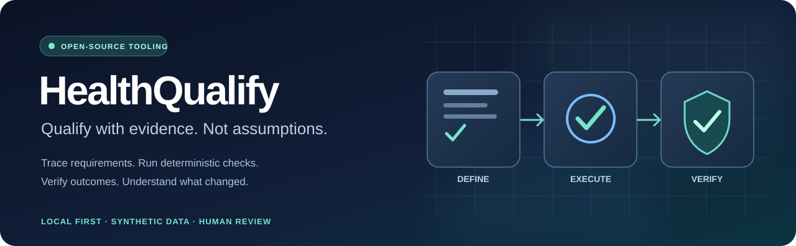
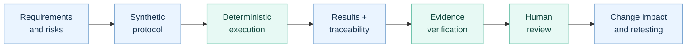

<div align="center">



### Open-source healthcare software qualification & technical evidence

**From requirements to verifiable test results—without black-box approvals.**  
A local-first toolkit for deterministic synthetic testing, traceability, review-ready evidence, and conservative change-impact analysis.

[**Get started**](#quick-start) · [**Explore capabilities**](#what-you-can-do) · [**Browse documentation**](docs/DOCUMENTATION_INDEX.md) · [**Try the guided evaluation**](docs/EVALUATION_GUIDE.md)

    

</div>

> [!IMPORTANT]
> **Developer alpha — not a regulated validation or clinical product.** Use only synthetic or public non-sensitive data. **No PHI, production healthcare connections, medical-device control, automatic qualification approval, or FDA/GxP certification.** A passing assertion or integrity receipt is technical evidence, not regulatory sign-off. [Security and limitations →](docs/SECURITY_AND_LIMITATIONS.md)

---

## Why HealthQualify?

**Most tests tell you whether code passed. HealthQualify helps you explain what was tested, why it matters, what evidence exists, and what to review when software changes.**

Healthcare software teams often need to connect an intended use and requirement to a test, an observed result, an investigation, and a later retest. HealthQualify makes that engineering trail easier to inspect while keeping final quality decisions in human hands.

| **01 · Define** | **02 · Execute** | **03 · Verify** |
| :--- | :--- | :--- |
| Link source-backed requirements, acceptance criteria, risk tags, and explicit synthetic fixtures. | Run allowlisted deterministic checks with clear **PASS / FAIL / ERROR / NOT_RUN** outcomes. | Inspect traceability, compare evidence against an independently saved SHA-256 digest, and replay supported checks. |
| [Protocol configuration →](docs/CONFIGURATION.md) | [Hands-on workflow →](docs/END_TO_END_WORKFLOW.md) | [Evidence verification →](docs/VERIFICATION_GUIDE.md) |

### Built for people who need to understand the result

| 🧑‍💻 **Developers & integrators** | 🧪 **Validation & QA engineers** | 🏥 **Healthcare IT teams** |
| :--- | :--- | :--- |
| Build safe synthetic assertions, inspect failures, and assess changes to code. | Follow requirements, risk, traceability, deviations, and evidence through a review process. | Explore synthetic LIS, HL7, limited FHIR, and other non-production interface scenarios. |
| [Developer architecture](docs/DEVELOPER_ARCHITECTURE.md) | [Qualification methodology](docs/QUALIFICATION_METHODOLOGY.md) | [Healthcare use cases](docs/HEALTHCARE_USE_CASES.md) |

---

## Quick start

**One repository. Python 3.10+ (3.12 recommended). No cloud account or AI API key required** for the offline synthetic runner.

```bash
git clone https://github.com/Tec-Wel/HealthQualify.git
cd HealthQualify

# Check the installation and core behavior
python -m unittest discover -s tests -v

# Generate a new, traceable synthetic evidence bundle
python -m healthqualify.v05cli run \
  examples/synthetic_lis_v3/protocol.json \
  --out .healthqualify/first-run
```

> [!NOTE]
> **The demo is designed to find problems.** Expect **2 PASS and 5 FAIL**, with exit code **1** from the final command. Those five failures are intentionally seeded into a fictional laboratory integration fixture; they do **not** mean installation failed. Choose a new `--out` directory for every run. On Windows, use `py -3` as needed and place the command on one line in PowerShell.

**What did you generate?**

```text
.healthqualify/first-run/
  ├── protocol.json   # The exact test definition and synthetic fixtures
  ├── results.json    # Per-test outcomes and requirement traceability
  └── manifest.json   # Artifact checksums and provenance metadata
```

The runner prints `manifest_sha256`. Save that digest **outside the evidence folder**, then verify:

```bash
python -m healthqualify.v05cli verify \
  .healthqualify/first-run \
  --trusted-manifest-sha256 YOUR_SAVED_DIGEST
```

Expected: `{"verified": true}` when the trusted manifest, artifact hashes, and deterministic replay match.

[**Full installation by OS →**](docs/INSTALLATION.md) · [**Step-by-step first run →**](docs/GETTING_STARTED.md) · [**Learn to interpret results →**](docs/VERIFICATION_GUIDE.md)

---

## What you can do

| Capability | What works in the developer alpha | Start here |
| :--- | :--- | :--- |
| **🔎 Synthetic qualification** | Strict offline v0.3 JSON protocols, source-linked requirements, bounded deterministic assertions and traceability | [Examples](docs/EXAMPLES.md) |
| **🧾 Evidence integrity** | SHA-256 manifests, independent trusted digest checks and deterministic replay | [Verification guide](docs/VERIFICATION_GUIDE.md) |
| **🧭 Change-impact analysis** | Source-path-to-test mapping and conservative `UNKNOWN_IMPACT` when changes aren't mapped | [End-to-end workflow](docs/END_TO_END_WORKFLOW.md) |
| **📋 Local QA workspace** | SQLite system records, v0.2 draft/baseline/run lifecycle, deviations, audit trail and technical reports | [User guide](docs/USER_GUIDE.md) |
| **🛡️ Local security & technical review** | Loopback-only authenticated API, role controls, technical reviewer records, backup and offline QMS handoff | [API reference](docs/API_REFERENCE.md) |
| **🏥 Limited interoperability checks** | Restricted synthetic REST/FHIR checks and offline HL7/DICOM/equipment prototypes | [Integration guide](docs/INTEGRATION_GUIDE.md) |
| **🤖 Five investigation agents** | Draft-only deterministic agent analyses; optional local Ollama/Qwen explanations and local loopback dashboard | [AI agents guide](docs/AI_AGENTS_GUIDE.md) |
| **⚙️ Release & quality analysis** | Human-reviewed release-impact advisories, local evidence retention metadata, synthetic comparison benchmark | [Quality & release guide](docs/QUALITY_RELEASE_BENCHMARK_V06.md) |

**These are not interchangeable workflows.** The standalone **v0.5 runner uses strict v0.3 protocols**; the SQLite workspace uses **v0.2 protocols**. There is no automatic protocol conversion or production QMS integration. See [Feature matrix](docs/FEATURE_MATRIX.md) for implemented, experimental, planned, and unsupported capabilities.

## How the workflow fits together



This is the **conceptual qualification journey**, not one automatically orchestrated regulated pipeline. The two protocol generations and the human QMS handoff remain distinct.

---

## Explore the five local investigation agents

Five agent roles help users *investigate* technical findings without changing test results or granting approvals.

| Agent | Question it helps answer |
| :--- | :--- |
| **Release Impact** | Which synthetic tests should I reconsider after a code change? |
| **Qualification Gap Hunter** | Which requirements lack an executed verification path? |
| **Failure Investigation Copilot** | What context should I examine for a nonpassing synthetic test? |
| **QA Evidence Readiness** | Which technical evidence or traceability gaps remain? |
| **Cross-System Dependency Investigator** | Which declared dependencies could affect the change review? |

```bash
# Run the agent tests
python -m unittest tests.test_agents tests.test_agent_orchestrator -v

# Explore a deterministic qualification-gap analysis
python -m healthqualify.agentcli gap-hunter examples/synthetic_lis_v3/protocol.json
```

A **single-user, loopback-only local dashboard** is also available on `127.0.0.1:8899`. It requires a random `HEALTHQUALIFY_AGENT_TOKEN` of at least 32 characters, explicitly configured synthetic inputs and separate setup steps; do not expose it publicly.

[**Five-agent user guide →**](docs/AI_AGENTS_GUIDE.md) · [**Dashboard setup →**](docs/AI_AGENT_DASHBOARD.md)

---

## Choose your documentation path

| **🌱 New to HealthQualify** | **🛠️ Building or extending** | **🏥 Evaluating for healthcare QA** |
| :--- | :--- | :--- |
| [Getting started](docs/GETTING_STARTED.md) | [Developer architecture](docs/DEVELOPER_ARCHITECTURE.md) | [Qualification methodology](docs/QUALIFICATION_METHODOLOGY.md) |
| [Installation](docs/INSTALLATION.md) | [CLI reference](docs/CLI_REFERENCE.md) | [Validation templates](docs/VALIDATION_TEMPLATES.md) |
| [End-to-end tutorial](docs/END_TO_END_WORKFLOW.md) | [Custom assertions & adapters](docs/CUSTOM_ADAPTER_GUIDE.md) | [30–60 min evaluation](docs/EVALUATION_GUIDE.md) |
| [FAQ & troubleshooting](docs/FAQ.md) | [Testing & CI](docs/TESTING_AND_CI.md) | [Security and limits](docs/SECURITY_AND_LIMITATIONS.md) |

<div align="center">

### Looking for a specific guide?

**[📚 Open the complete documentation center →](docs/DOCUMENTATION_INDEX.md)**

</div>

---

## Project status & trust boundaries

| **Designed for today** | **Not a capability claim** |
| :--- | :--- |
| Synthetic/public non-sensitive engineering evaluation | Live clinical qualification or patient-data processing |
| Deterministic fixture tests and inspectable results | Automated compliance certifications or qualified electronic signatures |
| Local SQLite, technical review receipts, and bounded adapters | Enterprise identity, production multi-tenancy, or validated immutable records |
| Conservative test recommendations after code changes | Deployment authorization or completed regulatory validation |

For the latest scope and known gaps, consult [Release status](docs/RELEASE_STATUS.md), [Security model](docs/SECURITY_MODEL.md), [Production readiness gates](docs/PRODUCTION_READINESS_CHECKLIST.md), and [Roadmap](docs/ROADMAP.md).

## Contributing & community

HealthQualify welcomes reproducible bug reports, documentation improvements, synthetic scenarios, safe deterministic checks, and carefully scoped integrations. Contributions should add tests, preserve evidence integrity, and keep clinical/regulatory approval decisions separate.

[**Contributing**](CONTRIBUTING.md) · [**Open issues**](https://github.com/Tec-Wel/HealthQualify/issues) · [**Security reporting**](SECURITY.md) · [**Support**](SUPPORT.md) · [**Changelog**](CHANGELOG.md) · [**Apache-2.0 license**](LICENSE)

---

<div align="center">

**A clearer path from what you intended to test to what you can actually verify.**

[**🚀 Run your first test**](docs/GETTING_STARTED.md) · [**🧭 Browse all docs**](docs/DOCUMENTATION_INDEX.md) · [**↗ Why HealthQualify**](#why-healthqualify)

<sub>Local first · AI optional · Synthetic only · Human-reviewed quality decisions</sub>

</div>
