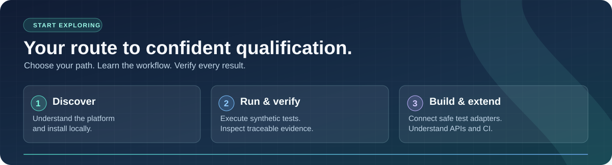

# HealthQualify

**Open-source, self-hostable healthcare software qualification tooling.** Track the path from intended use and requirements through synthetic test execution, evidence, review, and change-impact assessment.

> **Release status: v0.5 developer alpha.** HealthQualify is **not** a validated regulated system, medical device, clinical decision support system, regulatory certification, or a replacement for an organization's quality management system (QMS). Use **synthetic or public non-sensitive data only**. Do not connect it to production healthcare systems or ingest PHI.

## Why HealthQualify?

Healthcare software teams need to answer more than “did our unit tests pass?” They must know **what requirement was tested**, **what assertion executed**, **what evidence was recorded**, **what failed**, and **what needs requalification when software changes**.

HealthQualify provides a deterministic, AI-optional engineering foundation for that journey. It does **not** automatically provide a legal approval or compliance determination.

### Who is it for?

- **Software and integration developers:** test documented system contracts, examine deterministic failures, and assess change impact.
- **Validation and quality engineers:** create traceable protocol drafts, inspect technical evidence, and identify gaps.
- **Healthcare IT and laboratory integration teams:** experiment safely with synthetic LIS, HL7 and FHIR fixtures.
- **Open-source contributors:** develop and test adapters, assertions, governance and evidence workflows.

## Five local AI agents (developer alpha)

Five deterministic, **draft-only** investigators: Release Impact, Qualification Gap Hunter, Failure Investigation Copilot, QA Evidence Readiness, and Cross-System Dependency Investigator. An optional local Ollama/Qwen model can explain findings; it cannot change test outcomes or approve qualification.

**Start here:** [Agent user guide](docs/AI_AGENTS_GUIDE.md) · [Local dashboard and orchestration](docs/AI_AGENT_DASHBOARD.md)

```bash
python -m unittest tests.test_agents tests.test_agent_orchestrator -v
python -m healthqualify.agentcli gap-hunter examples/synthetic_lis_v3/protocol.json
# Set a random 32+ character HEALTHQUALIFY_AGENT_TOKEN before running:
python -m healthqualify.agent_dashboard
# Then open http://127.0.0.1:8899
```

The dashboard is single-user, loopback-only and restricted to configured synthetic inputs. **Not qualified for regulated production use.**

## Quick start: synthetic qualification in a local checkout

Requires **Python 3.10+** (3.12 recommended) and Git. Run from the repository root. The core synthetic runner uses the Python standard library.

```bash
git clone https://github.com/Tec-Wel/HealthQualify.git
cd HealthQualify
python -m unittest discover -s tests -v
python -m healthqualify.v05cli run examples/synthetic_lis_v3/protocol.json --out .healthqualify/demo-run
```

**Expected:** the synthetic example produces **2 PASS and 5 FAIL**, and the final command exits **1 on purpose**. The fixture simulates failures; that is not a failed installation. Use a **new output directory** for each run. On Windows, `py -3` may replace `python`.

For verification, preserve the SHA-256 digest printed as `manifest_sha256` by the runner **outside the evidence directory**:

```bash
python -m healthqualify.v05cli verify .healthqualify/demo-run --trusted-manifest-sha256 YOUR_SAVED_64_CHARACTER_DIGEST
```

Expect `{"verified": true}` if the artifacts and trusted digest match and deterministic replay confirms the results. Saving the digest beside a mutable report is not independent trust.

**Next:** [Getting started](docs/GETTING_STARTED.md) · [Installation](docs/INSTALLATION.md) · [End-to-end workflow](docs/END_TO_END_WORKFLOW.md)

## What is actually implemented?

| Capability | Current developer-alpha state | Important boundary |
| --- | --- | --- |
| v0.5 synthetic protocol runner | Strict JSON 0.3 protocol, deterministic offline assertions, PASS/FAIL/ERROR/NOT_RUN | Embedded synthetic/public fixtures, not arbitrary application test discovery |
| Evidence verification | Protocol, results, manifest, SHA-256, trusted digest and deterministic replay | Not immutable storage, trusted timestamps, or regulated approval |
| Change impact | Repository-relative file-to-test mapping with conservative unknown-impact fallback | Advisory; requires human review and complete mappings |
| v0.3 workspace | Local SQLite system registry, v0.2 protocol draft/baseline, runs, deviations, audit and report | Separate workflow from the standalone v0.5 runner |
| Secure API alpha | Loopback-only authenticated HTTP API, role checks, session tokens | No production TLS, MFA/SSO, multi-tenancy or PHI handling |
| Interoperability prototypes | Restricted read-only FHIR, synthetic MLLP inspection, offline DICOM metadata, passive equipment snapshot | Not a live full HL7/PACS/equipment qualification suite |
| Backup and signed technical exports | SQLite integrity backup/restore, optional encrypted technical evidence exports | No production key management, retention policy, or qualified e-signatures |
| AI assistance | Optional local draft suggestions | Never writes authoritative test verdicts or approvals |

The product roadmap and nine development issues remain separate from completion claims. See [Release status](docs/RELEASE_STATUS.md), [Backlog](docs/V05_BACKLOG_CONVERGENCE.md), and [Open issues](https://github.com/Tec-Wel/HealthQualify/issues).

## v0.6 quality, release and benchmarking workflows

[QA review, release impact and equal-input benchmark guide](docs/QUALITY_RELEASE_BENCHMARK_V06.md) covers credential-verified deviation reviews, offline QMS handoff, evidence-retention inventory, release-triggered test recommendations, human review decisions and measured synthetic benchmarks.

These are **developer-alpha controls only**, not legally valid electronic signatures, verified WORM retention, hospital integrations or automatic qualification decisions.

## 📚 Documentation



> **New to HealthQualify?** Follow the guided path below. Already building? Jump straight to the developer resources. All examples use **synthetic data**; this project is a developer alpha, not a validated clinical or regulated system.

### Find your starting point

| 🌱 **I'm new here** | 🧪 **I want to try it** | 🛠️ **I'm building with it** |
| :---: | :---: | :---: |
| Understand what HealthQualify does and install it on your machine. | Run the synthetic LIS example and inspect the evidence yourself. | Integrate an adapter, extend the engine, or contribute code. |
| **[🚀 Start the guided tour](docs/GETTING_STARTED.md)** | **[▶️ Run the full workflow](docs/END_TO_END_WORKFLOW.md)** | **[⌘ Explore developer docs](docs/DEVELOPER_ARCHITECTURE.md)** |
| [Installation](docs/INSTALLATION.md) · [User guide](docs/USER_GUIDE.md) | [Examples](docs/EXAMPLES.md) · [Verify results](docs/VERIFICATION_GUIDE.md) | [API reference](docs/API_REFERENCE.md) · [Contribute](CONTRIBUTING.md) |

### 🧭 Your first successful qualification

| Step | What you'll accomplish | Guide |
| :--- | :--- | :--- |
| **01 · Set up** | Install Python, clone the repository and run the checks. | [Installation by OS →](docs/INSTALLATION.md) |
| **02 · Run** | Execute a synthetic qualification with **2 expected passes / 5 seeded failures**. | [Hands-on examples →](docs/EXAMPLES.md) |
| **03 · Verify** | Inspect results, traceability and a manifest checked against a separately saved digest. | [Evidence verification →](docs/VERIFICATION_GUIDE.md) |
| **04 · Understand** | Follow the requirements → execution → evidence → review lifecycle. | [End-to-end walkthrough →](docs/END_TO_END_WORKFLOW.md) |

### 🗂️ Explore by topic

| | |
| :--- | :--- |
| **📖 Learn & use**<br>Build confidence with the fundamentals.<br><br>[User guide](docs/USER_GUIDE.md) · [FAQ](docs/FAQ.md)<br>[CLI commands](docs/CLI_REFERENCE.md) · [Configuration](docs/CONFIGURATION.md)<br>[Troubleshooting](docs/TROUBLESHOOTING.md) | **🔌 Build & integrate**<br>Extend HealthQualify for your own workflows.<br><br>[API reference](docs/API_REFERENCE.md) · [Architecture](docs/ARCHITECTURE.md)<br>[Integration guide](docs/INTEGRATION_GUIDE.md) · [Custom adapters](docs/CUSTOM_ADAPTER_GUIDE.md)<br>[Testing & CI](docs/TESTING_AND_CI.md) |
| **🏥 Healthcare qualification**<br>Explore the intended-use, risk and test methodology.<br><br>[Healthcare use cases](docs/HEALTHCARE_USE_CASES.md) · [Qualification methodology](docs/QUALIFICATION_METHODOLOGY.md)<br>[Regulatory mapping](docs/REGULATORY_MAPPING.md) · [Validation templates](docs/VALIDATION_TEMPLATES.md) | **🛡️ Security & operations**<br>Know the boundaries before deployment.<br><br>[Security & limitations](docs/SECURITY_AND_LIMITATIONS.md) · [Security model](docs/SECURITY_MODEL.md)<br>[Deployment guide](docs/DEPLOYMENT_GUIDE.md) · [Operations runbook](docs/OPERATIONS_RUNBOOK.md)<br>[Production readiness checklist](docs/PRODUCTION_READINESS_CHECKLIST.md) |

<details>
<summary><strong>📦 More guides — adoption, evaluation & project reference</strong></summary>

<br>

| Explore | Resources |
| :--- | :--- |
| **Evaluate** | [30–60-minute evaluation](docs/EVALUATION_GUIDE.md) · [Feature matrix](docs/FEATURE_MATRIX.md) · [Migration assessment](docs/MIGRATION_GUIDE.md) |
| **Deep dive** | [Developer architecture](docs/DEVELOPER_ARCHITECTURE.md) · [Release status](docs/RELEASE_STATUS.md) · [Quality & release workflows](docs/QUALITY_RELEASE_BENCHMARK_V06.md) |
| **Project** | [Changelog](CHANGELOG.md) · [Versioning policy](docs/VERSIONING_POLICY.md) · [Contributing](CONTRIBUTING.md) · [License](LICENSE) |
| **Community** | [Support](SUPPORT.md) · [Security reporting](SECURITY.md) · [GitHub issues](https://github.com/Tec-Wel/HealthQualify/issues) |

</details>

**Still exploring?** **[Browse the complete documentation index →](docs/DOCUMENTATION_INDEX.md)**

*Self-hostable · AI optional · Synthetic-data developer alpha · No PHI or production clinical integrations*

## Conceptual lifecycle

```text
Intended use / system registry
            ↓
Source-backed requirements and risks
            ↓
Draft protocol + explicit expected outcomes
            ↓
Human review of scope / authorized test environment
            ↓
Deterministic execution ──> PASS / FAIL / ERROR / NOT_RUN
            ↓
Manifest + technical evidence + integrity verification
            ↓
Deviation investigation / correction / distinct retest
            ↓
Human release disposition under the organization's QMS
            ↓
Software change → conservative impact assessment → requalification
```

The diagram is the **intended workflow**. Current components live in **two distinct tracks**: v0.5 standalone synthetic execution, and v0.3 SQLite workspace based on v0.2 protocols. Do not assume one command automatically moves records between them.

## Local deployment, not public hosting

The Compose file initializes a local SQLite developer workspace and **does not publish an HTTP port**. The secure API can be run separately on `127.0.0.1:8877` with explicit user bootstrap. See [Installation](docs/INSTALLATION.md) and [Integration](docs/INTEGRATION_GUIDE.md). Never expose alpha APIs on the internet.


## Contributing and support

Read [CONTRIBUTING.md](CONTRIBUTING.md), run the unit suite, and file reproducible issues with **synthetic sanitized** examples. For security-sensitive findings, do not publish secrets or PHI in an issue. Apache-2.0 license: [LICENSE](LICENSE).
