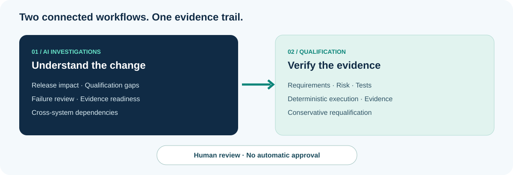
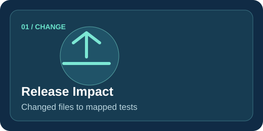
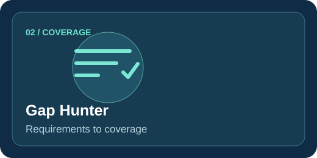
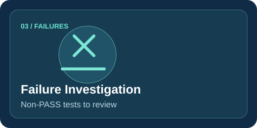
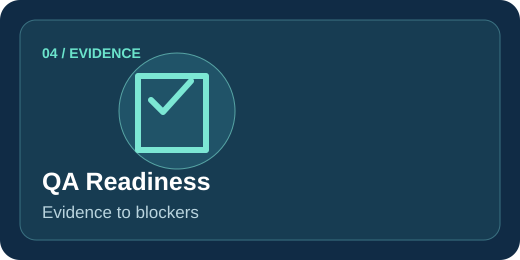
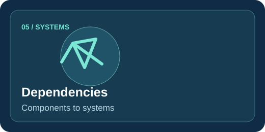
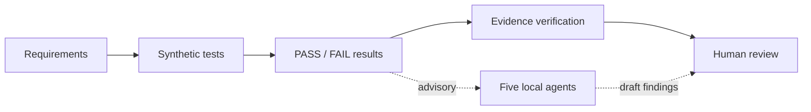

### Open-source software qualification & local AI investigations

**Trace requirements → run synthetic checks → verify evidence → investigate what changed.**

[**🚀 Get started**](#start-in-minutes) · [**📚 Documentation**](docs/index.md) · [**🤖 Five AI agents**](#meet-the-five-local-investigators) · [**🧪 Guided evaluation**](docs/EVALUATION_GUIDE.md)

   

> [!IMPORTANT]
> **Synthetic developer alpha.** Not FDA certification, validated GxP software, Part 11 electronic signatures, medical-device control, or production clinical use. No PHI. AI findings are advisory and never grant qualification approval. [Read the security boundaries](docs/SECURITY_AND_LIMITATIONS.md).

## Trust, license and public-launch status

HealthQualify is licensed under **[Apache-2.0](LICENSE)**. The project is currently a **private developer-alpha repository preparing for public release**; it must not be described as a cleared, qualified, or production-ready clinical platform. Public visibility and binary releases require separate owner/IP, security/history, third-party-license and distribution approval.

**Read before use or contribution:** [Privacy](PRIVACY.md) · [Safety/FDA disclaimer](DISCLAIMER.md) · [Security reporting](SECURITY.md) · [Third-party notices](THIRD_PARTY_NOTICES.md) · [Contributor guide](CONTRIBUTING.md) · [Code of Conduct](CODE_OF_CONDUCT.md) · [Governance](GOVERNANCE.md) · [Public-launch readiness checklist](docs/PUBLIC_LAUNCH_READINESS.md).

**No mandatory cloud account, paid API key or LLM subscription.** The core runs locally with synthetic data. The optional local Ollama/Qwen setup is separate and not bundled; operating hardware and downloaded software have their own licensing and privacy considerations.

## New Astro website + MkDocs documentation experience

A professional, original MONAI-inspired **Astro** landing website is maintained under [`website/`](website/README.md), alongside the existing searchable **MkDocs Material** portal. Both build into one static site under the planned GitHub Pages path `/HealthQualify/`, with documentation at `/HealthQualify/docs/`.

- [Website preview build workflow](.github/workflows/website-build.yml) — creates a GitHub Actions artifact; **no public deployment while launch gate #36 is open**.
- [Public launch and security gates](docs/PUBLIC_LAUNCH_READINESS.md) — repository remains private pending maintainer authorization.
- Astro is static, has no paid hosted APIs, trackers or mandatory cloud runtime. Existing Python agents and CLI remain untouched.

## 🖥️ Local Edition v0.8 — install, sign in, qualify

**No cloud account, purchased API token, mandatory LLM, or AI subscription.** The local edition bundles a guided synthetic LIS qualification journey, five offline-capable advisory agents, traceability/evidence views, a QA draft-review queue and optional local Qwen explanations.

**From a source checkout with Python 3.10+:** double-click `launch-healthqualify.bat` on Windows, or run `sh launch-healthqualify.command` on macOS / `sh launch-healthqualify.sh` on Linux. Alternatively run:

```bash
python -m healthqualify.local_edition_v08
```

It opens a **loopback-only** workspace at `http://127.0.0.1:8899`; create a local admin on first launch. No copy-pasted dashboard token is required. For an optional model already installed with Ollama, use `--allow-local-qwen`; the application remains fully usable without it.

[Local Edition installation and guided workflow](docs/LOCAL_EDITION_V08.md) · [Standalone developer bundle workflow](.github/workflows/local-edition-build.yml)

> **Developer alpha only:** demonstration executions are DRAFT technical runs; findings and QA queue decisions are **not** formal approvals, regulated electronic signatures, or patient-care evidence. The native bundles are created by an optional manual GitHub workflow and have not been independently signed or notarized.

## One product. Two complementary workflows.



| **01 · AI investigations** | **02 · Qualification & evidence** |
| :--- | :--- |
| Understand changed software components, unmapped requirements, failed synthetic tests, review blockers, and dependencies. | Define synthetic protocols, run deterministic checks, inspect results, verify artifact hashes, and maintain traceability. |
| **[Meet the five agents →](docs/AI_AGENTS_GUIDE.md)** | **[Explore the user guide →](docs/USER_GUIDE.md)** |

The agents **explain and investigate**; the deterministic engine produces test results. Final quality decisions require qualified human review. These are complementary developer-alpha workflows, not a single production-qualified system.

## Start in minutes

**Prerequisites:** Python 3.10+ and Git. No model installation, cloud account, or AI API key is needed.

```bash
git clone https://github.com/Tec-Wel/HealthQualify.git
cd HealthQualify
python -m unittest discover -s tests -v

# Run the synthetic qualification-gap investigation
python -m healthqualify.agentcli gap-hunter examples/synthetic_lis_v3/protocol.json
```

**Try the deterministic test runner:**

```bash
python -m healthqualify.v05cli run examples/synthetic_lis_v3/protocol.json --out .healthqualify/first-run
```

> [!NOTE]
> This intentionally seeded fixture yields **2 PASS and 5 FAIL**; exit code **1 is expected**. The runner prints a `manifest_sha256` value. Preserve it independently before following the [evidence verification guide](docs/VERIFICATION_GUIDE.md).

**[Windows / macOS / Linux installation →](docs/INSTALLATION.md)** · **[Full example walkthrough →](docs/END_TO_END_WORKFLOW.md)** · **[CLI reference →](docs/CLI_REFERENCE.md)**

## Meet the five local investigators

| | | |
| :--- | :--- | :--- |
| [](docs/AI_AGENTS_GUIDE.md#2-choose-the-right-agent) | [](docs/AI_AGENTS_GUIDE.md#2-choose-the-right-agent) | [](docs/AI_AGENTS_GUIDE.md#2-choose-the-right-agent) |
| [](docs/AI_AGENTS_GUIDE.md#2-choose-the-right-agent) | [](docs/AI_AGENTS_GUIDE.md#2-choose-the-right-agent) | **Local · Read-only · Draft output**<br>Optional Ollama/Qwen explanations with deterministic findings kept separate.<br>**[Agent user guide →](docs/AI_AGENTS_GUIDE.md)** |

**Learn how the agents work:** [All five CLI commands](docs/AI_AGENTS_GUIDE.md) · [Local dashboard setup](docs/AI_AGENT_DASHBOARD.md).

### Explore the local dashboard

The repository includes a **single-user, loopback-only** dashboard at `127.0.0.1:8899`. It supports five-agent execution and local investigation history. A random `HEALTHQUALIFY_AGENT_TOKEN` (32+ characters) is required.

**[Launch and use the dashboard →](docs/AI_AGENT_DASHBOARD.md)**

> [!NOTE]
> A reproducible, actual dashboard screenshot has **not yet been committed**. We are using labeled illustrations rather than presenting mockups as product screenshots. See the [screenshot capture guide](docs/VISUAL_ASSETS_GUIDE.md) for the controlled synthetic-only capture process.

## How qualification remains traceable



**Important:** Standalone strict **v0.3** synthetic protocols and the separate **v0.2** SQLite workspace do not automatically bridge. Neither issues regulatory approval. [See the feature matrix](docs/FEATURE_MATRIX.md).

## Find what you need

| **Evaluate & use** | **Build & extend** | **Review trust boundaries** |
| :--- | :--- | :--- |
| [Five-minute start](docs/GETTING_STARTED.md) | [Architecture](docs/DEVELOPER_ARCHITECTURE.md) | [Security model](docs/SECURITY_MODEL.md) |
| [Qualification guide](docs/USER_GUIDE.md) | [CLI / API reference](docs/CLI_REFERENCE.md) | [Production-readiness checklist](docs/PRODUCTION_READINESS_CHECKLIST.md) |
| [Evidence verification](docs/VERIFICATION_GUIDE.md) | [Testing & CI](docs/TESTING_AND_CI.md) | [Feature matrix](docs/FEATURE_MATRIX.md) |
| [Documentation hub](docs/index.md) | [Contribution guide](CONTRIBUTING.md) | [Release status](docs/RELEASE_STATUS.md) |

## Contribute to HealthQualify

We welcome documentation improvements, accessible UI contributions, reproducible synthetic scenarios, safety-focused fixes, and reviewed test adapters.

**[Start contributing →](CONTRIBUTING.md)** · **[Choose an issue →](https://github.com/Tec-Wel/HealthQualify/issues)** · **[Report a vulnerability →](SECURITY.md)** · **[Project support →](SUPPORT.md)**

---

**Evidence first · Local AI optional · Synthetic inputs · Human accountability**

[Documentation](docs/index.md) · [Changelog](CHANGELOG.md) · [License](LICENSE) · [Visual design guidelines](docs/DESIGN_GUIDELINES.md)
