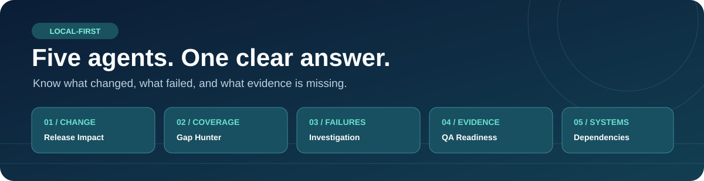
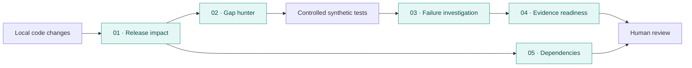

# Meet the five local AI agents

**Investigate qualification changes with repeatable findings—not black-box approvals.**

[**🚀 Try your first agent**](#1-your-first-agent-in-60-seconds) · [**🧭 Explore the five agents**](#2-choose-the-right-agent) · [**🧪 Verify test evidence**](#3-work-with-verified-evidence) · [**🖥️ Open the dashboard guide**](AI_AGENT_DASHBOARD.md)


> [!IMPORTANT]
> **Developer alpha — synthetic v0.3 protocols only.** These are *advisory investigators*, not FDA validation approvals, production GxP systems, qualified electronic signatures, or clinical tools. Use only synthetic/public nonsensitive inputs. Never send PHI or connect the demonstration to live systems.

## Find your path

| **🌱 New to agents** | **🧪 I have test results** | **🖥️ I prefer a UI** |
| :--- | :--- | :--- |
| Run a deterministic investigation with no LLM and no API key. | Verify the evidence bundle using an independently saved digest, then investigate failures. | Use the loopback dashboard to run agents and inspect local history. |
| **[Run the quickstart ↓](#1-your-first-agent-in-60-seconds)** | **[Verify evidence ↓](#3-work-with-verified-evidence)** | **[Launch the dashboard →](AI_AGENT_DASHBOARD.md)** |

---

## 1. Your first agent in 60 seconds

**Requirements:** Python 3.10+ and Git. No cloud credentials, Ollama install, or model download needed for the initial deterministic analysis.

```bash
git clone https://github.com/Tec-Wel/HealthQualify.git
cd HealthQualify
python -m unittest tests.test_agents tests.test_agent_orchestrator -v
```

Now ask the **Qualification Gap Hunter** to examine the built-in synthetic LIS project:

```bash
python -m healthqualify.agentcli gap-hunter examples/synthetic_lis_v3/protocol.json
```

**What to look for:** JSON with `"agent": "gap-hunter"`, `"status": "DRAFT_UNVERIFIED"`, `"qualification_approved": false`, a `summary` object, and source-linked `findings`. Without separately verified execution evidence, the agent explicitly reports `NO_VERIFIED_EXECUTION`.

> [!TIP]
> Start with deterministic analysis. The AI model is an **optional explanation layer**—the verification and traceability functions are useful without it.

## 2. Choose the right agent

| | **Agent** | **Question answered** | **What it actually checks today** |
| :---: | :--- | :--- | :--- |
| 🔀 | **01 · Release Impact Investigator** | *What should we review after this code change?* | Mapped paths → tests; unknown changes → `UNKNOWN_IMPACT` |
| 🔎 | **02 · Qualification Gap Hunter** | *What is untested or missing?* | Uncovered requirements, missing/non-PASS verified execution |
| 🧩 | **03 · Failure Investigation Copilot** | *Which failures need attention?* | Non-PASS synthetic tests, linked requirements, unverified investigation prompts |
| 📋 | **04 · QA Evidence Readiness** | *What prevents a complete review package?* | Evidence gaps and blockers; alpha stays `REVIEW_BLOCKED` |
| 🌐 | **05 · Cross-System Dependency Investigator** | *Which registered systems could be affected?* | Changed components → locally declared system dependencies; unknown mappings |

### The complete workflow at a glance



### Run any agent from the CLI

<details markdown="1">
<summary><strong>🔀 Agent 01 — Release Impact Investigator</strong></summary>

Find impacted synthetic tests when a mapped repository component changes:

```bash
python -m healthqualify.agentcli release-impact examples/synthetic_lis_v3/protocol.json --changed healthqualify/healthcare.py
```

Try an intentionally unknown component to see the conservative safety behavior:

```bash
python -m healthqualify.agentcli release-impact examples/synthetic_lis_v3/protocol.json --changed new/unmapped_component.py
```

**Expect:** `REVIEW_REQUIRED` for known mappings; `UNKNOWN_IMPACT` and a broad rerun recommendation when mappings are incomplete. This is not a qualified release decision.

</details>

<details markdown="1">
<summary><strong>🔎 Agent 02 — Qualification Gap Hunter</strong></summary>

```bash
python -m healthqualify.agentcli gap-hunter examples/synthetic_lis_v3/protocol.json
```

**Expect:** requirement coverage findings and an explicit warning when verified execution is missing. Negative-test coverage classification and historical baseline staleness are **not** independently proven by the alpha schema.

</details>

<details markdown="1">
<summary><strong>🧩 Agent 03 — Failure Investigation Copilot</strong></summary>

```bash
python -m healthqualify.agentcli failure-investigation examples/synthetic_lis_v3/protocol.json
```

**Expect:** a request for independently verified results. The evidence-based investigation command appears in [Step 3](#3-work-with-verified-evidence). A suspected cause is **not** a confirmed root cause.

</details>

<details markdown="1">
<summary><strong>📋 Agent 04 — QA Evidence Readiness</strong></summary>

```bash
python -m healthqualify.agentcli qa-readiness examples/synthetic_lis_v3/protocol.json
```

**Expect:** `REVIEW_BLOCKED`, because this synthetic alpha does not implement formal QA approval, even if technical fixtures pass.

</details>

<details markdown="1">
<summary><strong>🌐 Agent 05 — Cross-System Dependency Investigator</strong></summary>

```bash
python -m healthqualify.agentcli dependency-investigator examples/synthetic_lis_v3/protocol.json --registry examples/agents/dependencies.json --changed healthqualify/healthcare.py
```

**Expect:** declared affected systems and unmapped paths. The local registry is an explicit input, not automatic discovery of all real organization systems.

</details>

---

## 3. Work with verified evidence

The built-in protocol deliberately contains seeded defects. Run it through the **separate deterministic runner**:

```bash
python -m healthqualify.v05cli run examples/synthetic_lis_v3/protocol.json --out .healthqualify/demo-run
```

> [!NOTE]
> **Expected: 2 PASS, 5 FAIL, exit code 1.** This is the demonstration's intended outcome. The output folder must not already exist. The printed `manifest_sha256` is your evidence-verification reference.

**Save the printed digest outside the evidence directory**, in a location you independently control. Then verify the bundle:

```bash
python -m healthqualify.v05cli verify .healthqualify/demo-run --trusted-manifest-sha256 YOUR_TRUSTED_SHA256
```

Use exactly that separately preserved digest for the failure investigation:

```bash
python -m healthqualify.agentcli failure-investigation examples/synthetic_lis_v3/protocol.json --evidence-dir .healthqualify/demo-run --trusted-manifest-sha256 YOUR_TRUSTED_SHA256
```

The same `--evidence-dir` and `--trusted-manifest-sha256` flags also work with `gap-hunter` and `qa-readiness`. A missing or mismatched trusted hash stops evidence-based analysis. A local hash alone is not a qualified immutable record.

### What gets produced?

```text
Local synthetic protocol
      │
      ├── Deterministic analysis ───> source-linked draft findings
      │
      └── Explicit separate runner ─> protocol.json
                                    ├> results.json
                                    └> manifest.json
                                             │
                     Independently saved SHA-256
                                             │
                                Verified agent investigation
```

## 4. Optional: add Qwen explanations with Ollama

**Ollama does not train a model** here—it serves a locally installed Qwen model to explain the deterministic findings.

```bash
ollama pull qwen3:8b
ollama list
python -m healthqualify.agentcli gap-hunter examples/synthetic_lis_v3/protocol.json --ollama --model qwen3:8b
```

Keep Ollama bound to `127.0.0.1:11434`; disable cloud features and independently block unapproved outbound traffic. Only synthetic data summaries are permitted in this alpha. The model cannot alter `findings`, `summary`, `qualification_approved`, or `evidence`.

| **AI off (default)** | **AI on (explicit `--ollama`)** |
| :--- | :--- |
| Purely deterministic local findings | Same deterministic findings plus `model_explanation` |
| No model download or inference | Requires running local Ollama and Qwen |
| No model availability dependency | Model outage returns an error, **not** a PASS |

Real Qwen inference is a separate hardware acceptance test; successful automated CI does **not** prove a Qwen model was exercised.

## 5. Save and interpret a report

Save a new draft report without overwriting an existing file:

```bash
python -m healthqualify.agentcli gap-hunter examples/synthetic_lis_v3/protocol.json --out draft-gaps.json
```

The schema `HQ-AGENT-DRAFT-0.1` records the selected agent, source system, protocol hash, deterministic `summary`, `findings` with source references, and optional unverified model narrative.

| **Output** | **How to interpret it** |
| :--- | :--- |
| `DRAFT_UNVERIFIED` | Advisory result requiring human review |
| `UNKNOWN_IMPACT` | Mapping insufficient: do not assume the change is safe |
| `NO_VERIFIED_EXECUTION` | Test coverage cannot prove actual execution |
| `REVIEW_BLOCKED` | No formal approval readiness claim |
| `qualification_approved: false` | No regulatory or release approval was issued |

### Dependency-registry example

```json
{
  "systems": [
    {
      "id": "LIS",
      "components": ["healthqualify/healthcare.py"]
    }
  ]
}
```

The key is a **reviewed local mapping**, not a scanner capable of inferring every system dependency.

---

## 6. Safety, testing & next steps

> [!WARNING]
> **Do not use these developer-alpha agents as a regulated system of record.** They do not perform FDA approval, qualified signatures, CAPA closure, live clinical execution, model-driven shell commands, or validated enterprise audit/retention. Input protocols are bounded to 1 MiB and synthetic v0.3.

```bash
python -m unittest tests.test_agents tests.test_agent_orchestrator -v
python -m unittest discover -s tests -v
```

The tests exercise unknown changes, absent/invalid evidence, default-off inference, blocked approvals, path validation, and five-agent job execution. Passing them demonstrates developer behavior, not regulatory qualification.

<details markdown="1">
<summary><strong>Common questions and troubleshooting</strong></summary>

**Why is readiness always blocked?** The current synthetic protocol has no formal qualified-approval pathway.

**Why does the example exit with code 1?** It contains five deliberately failing checks.

**Why does the evidence agent reject my directory?** Supply both the directory and the independently preserved, exact `manifest_sha256` output from the run.

**Why does Qwen fail?** Check `ollama list`, confirm the Ollama service is running on `127.0.0.1:11434`, and use the exact installed model name.

**Can this process patient records or automatically validate my device?** No; synthetic or public nonsensitive inputs only, and no regulated production qualification claim.

</details>

---


### Continue your HealthQualify journey

[**🖥️ Launch the local dashboard →**](AI_AGENT_DASHBOARD.md) · [**📚 Documentation home →**](DOCUMENTATION_INDEX.md) · [**🔐 Review security boundaries →**](SECURITY_MODEL.md)

*Local first · AI optional · Evidence-aware · Human-reviewed*


