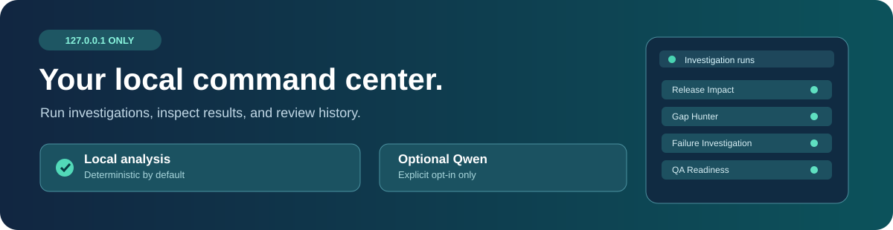
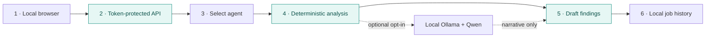
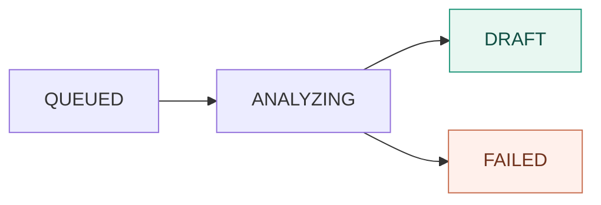

# The local agent dashboard

**A single place to run five investigations, inspect findings, and review local job history.**

[**⚡ Launch in three steps**](#1-launch-in-three-steps) · [**🧭 Take a guided tour**](#2-take-a-guided-tour) · [**🧠 Enable local Qwen**](#3-optional-enable-local-qwen) · [**🔐 Review the security model**](#5-understand-the-trust-boundary)


> [!IMPORTANT]
> **Synthetic developer alpha — not a production quality-management dashboard.** Use only synthetic/public nonsensitive inputs; do not ingest PHI, connect to clinical systems, or interpret advisory findings as FDA validation or release approval.

## Before you begin

| **You need** | **You do not need** |
| :--- | :--- |
| Python 3.10+ and Git | A cloud account or AI API key |
| A local checkout of HealthQualify | Qwen for deterministic analysis |
| A random dashboard token (32+ characters) | Production healthcare credentials |
| A browser on the same computer | Publicly accessible ports |

**Prefer the command line?** Start with the [Five AI Agents guide](AI_AGENTS_GUIDE.md) instead.

---

## 1. Launch in three steps

### Step 1 · Get HealthQualify

```bash
git clone https://github.com/Tec-Wel/HealthQualify.git
cd HealthQualify
python -m unittest tests.test_agents tests.test_agent_orchestrator -v
```

Use the **current `main` branch**; earlier feature-branch links are historical and may be removed.

### Step 2 · Set your local access token

<details markdown="1" open>
<summary><strong>🪟 Windows PowerShell</strong></summary>

```powershell
$env:HEALTHQUALIFY_AGENT_TOKEN = python -c "import secrets; print(secrets.token_urlsafe(40))"
python -m healthqualify.agent_dashboard
```

</details>

<details markdown="1">
<summary><strong>🐧 Linux / 🍎 macOS</strong></summary>

```bash
export HEALTHQUALIFY_AGENT_TOKEN="$(python -c 'import secrets; print(secrets.token_urlsafe(40))')"
python -m healthqualify.agent_dashboard
```

</details>

The access token is never printed by the dashboard; keep it available locally so you can enter it in the browser. If you lose it, stop the server and generate a new token. The demo server uses one local token and is not a replacement for enterprise identity or per-user authorization.

### Step 3 · Open the local dashboard

**Open [http://127.0.0.1:8899](http://127.0.0.1:8899) on the same computer.**

Enter the token you generated, select **Load history**, and choose a specific investigation or **Run all five agents**.

> [!TIP]
> Nothing is published to a public website. The dashboard binds to `127.0.0.1`; never forward this port to a shared or internet-facing interface.

---

## 2. Take a guided tour



| **Area** | **What the user does** | **What happens** |
| :--- | :--- | :--- |
| **Local access** | Enter the token and load history | Browser makes same-origin requests to the local API |
| **Five agent cards** | Choose one investigator | One bounded synchronous analysis runs |
| **Run all five** | Start the complete set | Five investigations execute serially, each recorded separately |
| **Run results** | Examine report JSON | Shows source-linked deterministic findings and optional explanation |
| **Local history** | Review previous jobs | SQLite records state, timestamps and draft output |
| **Qwen checkbox** | Opt in *when the server permits* | Adds model narration; does not change the underlying findings |

### What are the five agent cards?

| **Card** | **Best first use** |
| :--- | :--- |
| **01 · Release Impact** | Investigate changed files and affected synthetic tests |
| **02 · Gap Hunter** | Inspect missing requirement-to-test coverage |
| **03 · Failure Investigation** | Examine nonpassing execution, once verified evidence is available through the CLI |
| **04 · QA Readiness** | Understand why the synthetic review remains blocked |
| **05 · Dependencies** | Inspect components shared across registered systems |

The dashboard uses **server-configured synthetic inputs** and deliberately does not accept arbitrary file paths from the browser. Without an independently verified evidence bundle, failure-oriented findings will explain the missing execution context. Use the [agent CLI evidence workflow](AI_AGENTS_GUIDE.md#3-work-with-verified-evidence) for evidence-linked investigation.

### Agent states



**DRAFT ≠ approved.** An AI or deterministic investigation result never becomes a formal qualification approval automatically.

---

## 3. Optional: enable local Qwen

By default, the dashboard works without Ollama. For a draft narrative explaining the deterministic findings:

```bash
ollama pull qwen3:8b
ollama list
```

Start the local dashboard with Qwen permission explicitly enabled:

```bash
python -m healthqualify.agent_dashboard --allow-ollama
```

In the browser, select **Request optional local Qwen explanation** before starting an agent. Both the **server flag** and **per-run checkbox** are required.

| **No model selected** | **Local Qwen selected** |
| :--- | :--- |
| Deterministic findings only | Same findings plus `model_explanation` |
| No LLM request | Requests local Ollama at `127.0.0.1:11434` |
| No model dependency | If Ollama is unavailable, job records a failure |
| No external AI provider | Still requires OS/firewall egress controls for offline guarantees |

**Model text is a draft.** It cannot rewrite factual test results, issue an approval, or close a deviation.

---

## 4. Configure a demo workspace

The default dashboard is intentionally simple. To use your own **reviewed synthetic** protocol and registry, supply fixed local command-line paths:

```bash
python -m healthqualify.agent_dashboard --db .healthqualify/agent-history.db --protocol examples/synthetic_lis_v3/protocol.json --registry examples/agents/dependencies.json --changed healthqualify/healthcare.py --port 8899
```

The server's `--changed` paths are **explicit**, not live GitHub monitoring. The registry is maintained manually.

### For scriptable or evidence-specific workflows

Use the local orchestrator directly:

```bash
python -c "from healthqualify.agent_orchestrator import AgentHistory; h=AgentHistory('agents-demo.db'); result=h.run_all('demo_user','examples/synthetic_lis_v3/protocol.json',changed_files=['healthqualify/healthcare.py'],registry_path='examples/agents/dependencies.json'); print([(x['agent'],x['state']) for x in result['jobs']]); h.close()"
```

For separate evidence verification, use the [CLI guide](AI_AGENTS_GUIDE.md#3-work-with-verified-evidence). Neither the orchestrator nor dashboard grants release authority.

### Understanding local storage

```text
.healthqualify/agents.db
  ├── agent_jobs       # actor, state, draft report, bounded error
  └── agent_events     # application-level chained event hashes
```

**Hash chaining is not immutability.** The stored history can be changed by privileged local processes; independent anchoring, controlled retention and validated audit controls are required for regulated systems.

---

## 5. Understand the trust boundary

| **Current safeguards** | **Not yet supported** |
| :--- | :--- |
| Loopback binding and bearer-token access | Enterprise SSO / MFA / multiuser RBAC |
| Server-fixed sample paths; bounded request fields | Browser-selected arbitrary projects or production systems |
| Serial agent orchestration and local history | Qualified immutable WORM storage and external trusted timestamps |
| AI opt-in, draft-only explanation | Regulated electronic signatures or release approval |
| No model-driven shell commands or test execution | Validated production healthcare integrations |

> [!WARNING]
> **Not FDA-regulated production qualification.** Users must independently establish intended use, risk controls, documented software assurance, appropriate identities and segregation of duties, electronic-record controls where applicable, backup/restore, security assessment, model governance, and QA procedures. Passing CI does not satisfy those requirements.

## 6. Verify your setup

Run the agent and orchestration tests:

```bash
python -m unittest tests.test_agents tests.test_agent_orchestrator -v
python -m unittest discover -s tests -v
```

### Hardware Qwen acceptance checklist

- [ ] `ollama list` shows the exact reviewed model and digest is recorded.
- [ ] The dashboard starts with `--allow-ollama`.
- [ ] Each agent produces `model_explanation.status=DRAFT_UNVERIFIED` on approved synthetic input.
- [ ] Deterministic findings do not change between AI-off and AI-on runs.
- [ ] The experiment works with external network access blocked.
- [ ] Stopping Ollama causes a failed job, never a passing or approved result.
- [ ] Logs contain no sensitive/private clinical content.

Do not mark this complete without actual hardware-backed inference testing. The default CI suite uses mocks and deterministic cases.

<details markdown="1">
<summary><strong>🛠️ Troubleshooting</strong></summary>

**Cannot open the page:** Check that the command is still running and visit `127.0.0.1:8899` on the same machine.

**Unauthorized:** Set a fresh `HEALTHQUALIFY_AGENT_TOKEN`, restart the server and enter the same token into the dashboard.

**Job stays blocked:** The synthetic alpha intentionally returns review blockers. Formal QA approval is out of scope.

**Qwen fails:** Check `ollama list`, the local service on port `11434`, and the `--allow-ollama` server flag.

**Evidence missing:** The dashboard does not automatically execute tests. Run and verify synthetic evidence separately through the agent CLI.

</details>

---


### Explore what the agents can actually detect

[**🤖 Five-Agent User Guide →**](AI_AGENTS_GUIDE.md) · [**📚 Documentation Home →**](DOCUMENTATION_INDEX.md) · [**🧪 Testing & CI →**](TESTING_AND_CI.md)

*Private by default · Local workflows · Synthetic only · Human accountability*


