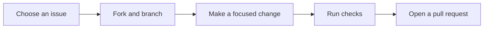

# Contribute to HealthQualify — a visual guide

Help build an open-source toolkit for verifiable synthetic software qualification. You can contribute **without running a local AI model**.

## Choose the right starting point

| **📖 Documentation** | **🎨 Visual UX** | **🧪 Synthetic QA** |
| :--- | :--- | :--- |
| Repair links, improve setup steps, and clarify supported behavior. | Improve SVG assets, responsive docs, accessible component styling and real screenshots. | Add deterministic fixtures, negative-path tests and transparent evidence examples. |
| [Browse documentation](DOCUMENTATION_INDEX.md) | [See the visual design system](DESIGN_GUIDELINES.md) | [Testing and CI](TESTING_AND_CI.md) |

## Five steps to your first contribution

1. Start at [GitHub Issues](https://github.com/Tec-Wel/HealthQualify/issues) and pick a scoped change.
2. Read the [contribution guidelines](../CONTRIBUTING.md) and open a feature branch.
3. If working on visuals, use the [design tokens](DESIGN_GUIDELINES.md) and only original/permitted assets.
4. Run `python -m unittest discover -s tests -v` and `python scripts/check_visual_assets.py`; for site changes, run `python -m mkdocs build`.
5. Open a PR with screenshots or before/after image comparisons for visual changes. Identify synthetic example data and accessibility checks.

> [!IMPORTANT]
> No PHI, customer production logs, private regulated records, or unlicensed standards text. UI improvements must not introduce automatic approval or overstate FDA regulatory readiness.

## First contribution checklist

- [ ] I can explain the change in one paragraph.
- [ ] The visuals render on GitHub and in MkDocs in light/dark mode.
- [ ] I checked keyboard focus and contrast.
- [ ] I did not add heavy trackers, remote fonts, or paid-only tools.
- [ ] Screenshots come from the real local demo or are labeled illustrations.
- [ ] Relevant local tests and documentation checks pass.

## Get help

[Open an issue](https://github.com/Tec-Wel/HealthQualify/issues) · [Contributing](../CONTRIBUTING.md) · [Support](../SUPPORT.md) · [Security reporting](../SECURITY.md)
