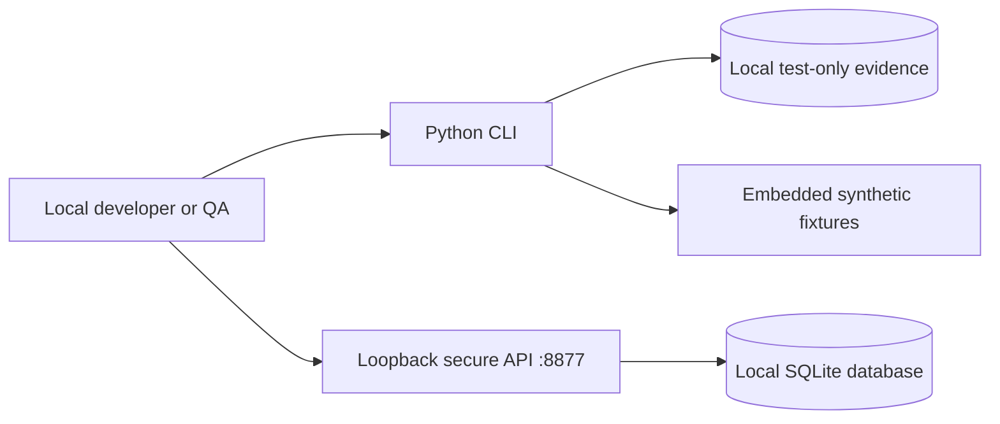

# Deployment guide: local now, enterprise designs later

**Current product status:** developer alpha, not a production or clinical deployment. This document separates **working local procedures** from **future reference architectures** for AWS, Azure, GCP and on-premises environments.

## What is deployed today?

- An offline Python test runner (`python -m healthqualify.v05cli`) reading synthetic JSON files.
- A SQLite developer workspace (`python -m healthqualify.appcli --db ... init`).
- A password-authenticated **loopback-only** API (`appcli serve`, default `127.0.0.1:8877`).
- A Docker Compose service that **initializes SQLite** but **does not expose the API**.

```bash
docker compose build
docker compose run --rm healthqualify
```

The Dockerfile copies Python modules, examples and tests, runs as an unprivileged user and does not establish a multi-service production architecture. Do **not** interpret successful container startup as a deployable hospital service.

## Local evaluation topology



Use only locally controlled data. If you run the API, bind only to localhost. Do not expose a reverse proxy or forwarded port to remote users.

## Proposed future enterprise reference architectures — NOT IMPLEMENTED

| Environment | Potential topology | Required unbuilt work |
| --- | --- | --- |
| AWS | Private compute / restricted load balancer / managed PostgreSQL / protected object storage / KMS | TLS termination, IAM, isolated workers, network policy, secrets, backup, WORM retention, monitoring, compliance qualification |
| Azure | Private compute / managed PostgreSQL / storage / Key Vault / identity | Tenant isolation, MFA, private networking, secrets, encryption, assurance qualification |
| GCP | Private compute / Cloud SQL / object storage / KMS / logging | Ingress/egress controls, access policies, backup, approval integration, penetration testing |
| Hospital on-prem | Segmented Linux host(s), managed PostgreSQL, protected file storage, central audit | Infrastructure validation, identity federation, patching, time sync, disaster recovery, BAA/DPA and site-specific policies |

These are **design considerations**, not tested deployment manifests. No Terraform, Kubernetes chart, secure production reverse proxy, cloud database migration or tested multi-tenancy is provided in this repo.

## Architecture controls required before any expansion

1. Approved intended-use and threat model, with data processing agreement and clinical scope decision.
2. Secure identity with MFA/SSO, appropriate role model, service accounts and separation of duties.
3. TLS everywhere, private ingress, default-deny egress and independently checked destination allowlists.
4. Proper secrets management and rotation; never store keys in source, shell logs or unencrypted volumes.
5. Backed-up, encrypted and monitored database/object storage, trusted timestamps and retention controls.
6. Observability and incident response without leaking sensitive payloads.
7. Controlled software release/version provenance, vulnerability scanning and change validation.
8. Disaster recovery tests and independently reviewable qualification of the tool itself.
9. Authorized QMS/electronic signature process where required.
10. Independent security/privacy/QA/regulatory sign-off.

## Configuration safety

Avoid pointing the alpha API at a public host; `serve_secure` explicitly rejects non-loopback hostnames. `HEALTHQUALIFY_API_TOKEN` applies to a **legacy API only**, not the secure login API. The signed technical export keys are environment variables and **do not** create production key governance.

## Operational next steps

For evaluation, follow [Installation](INSTALLATION.md) and [Evaluation](EVALUATION_GUIDE.md). For enterprise planning, use [Production readiness checklist](PRODUCTION_READINESS_CHECKLIST.md), [Security model](SECURITY_MODEL.md) and [Operations runbook](OPERATIONS_RUNBOOK.md) as a gap assessment, not a deployment authorization.
