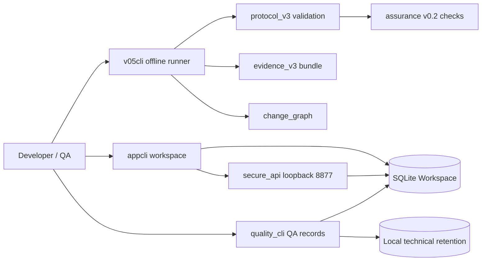
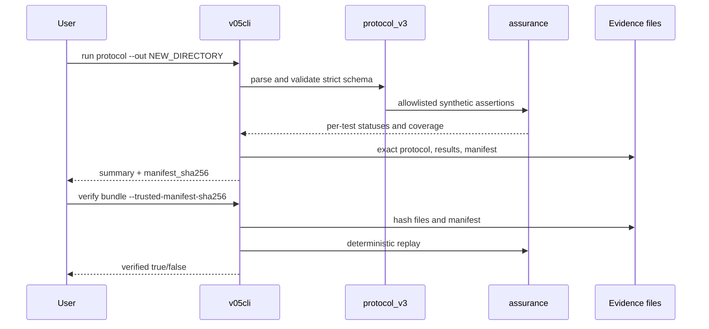

[← **Documentation home**](README.md) &nbsp; / &nbsp; **Build & extend**

# Developer architecture — components, execution and trust

> **What you'll learn:** Understand module boundaries, the two protocol generations, and the technical evidence pipeline.

**On this page:** [Purpose](#purpose) · [Context diagram](#context-diagram) · [Source map](#source-map) · [Critical distinction: two protocol generations](#critical-distinction-two-protocol-generations)

---

## Purpose

This guide explains current implemented module boundaries, not a proposed microservice architecture. HealthQualify is a **Python developer alpha** with offline deterministic testing, an optional local SQLite workspace, and a separate loopback authenticated API. Most capabilities are modules, not deployed services.

## Context diagram

## Source map

| Layer | Modules | Responsibilities and constraints |
| --- | --- | --- |
| Core assertions | `healthcare.py`, `assurance.py`, `engine.py` | Allowlisted synthetic checks and explicit statuses |
| Strict runner | `protocol_v3.py`, `evidence_v3.py`, `v05cli.py` | Reject unknown fields, disable network/AI/destructive, export and replay evidence |
| Change impact | `change_graph.py`, `ci_impact.py` | File mapping, conservative unknown impacts, PR advisory |
| Release plans | `release_qualification.py`, `release_ci.py`, `quality_cli.py` | SHA-bound release diff and credential-checked reviewer decisions; no approval |
| Workspace | `workspace.py`, `appcli.py`, `reports.py` | SQLite system, v0.2 drafts, baselines, runs, deviations, audit, exports |
| Security | `security.py`, `secure_api.py`, `protected_export.py` | Local roles/session tokens, loopback API, technical crypto export |
| Quality review | `deviation_review.py`, `capa.py`, `retention.py` | Controlled technical review, CAPA, offline QMS package, local retention metadata |
| Interop | `rest_local.py`, `fhir_secure.py`, `hl7_mllp.py`, `dicom_device.py` | Restricted test-only access and offline synthetic parsing |
| Optional drafts | `ai.py`, `ai_providers.py`, `modelqual.py` | Draft suggestions and offline metrics, no authoritative verdicts |
| Operational | `backup.py`, `regwatch.py`, `regulatory.py` | Backup integrity and operator-supplied regulatory references |

## Critical distinction: two protocol generations

- **Strict v0.3 JSON** → standalone `python -m healthqualify.v05cli run` → `protocol.json`, `results.json`, `manifest.json` + replay verification. It does not write to SQLite.
- **v0.2 JSON** → `python -m healthqualify.appcli` → SQLite registry, draft/baseline/run/deviation records. The secure API uses this same workspace. There is no automatic import bridge between the two.

A source reference string is not a cryptographically authenticated standard. A review event is not a Part 11 signature.

## Execution and evidence sequence

Trust anchors must live **outside** a mutable evidence bundle. Replay assumes trusted runner/verifier code. It cannot attest that a real clinical installation behaved the same as an embedded fixture.

## Design decisions

1. Default-offline and deterministic: no network or LLM in the strict protocol engine.
2. Fail closed: malformed checks, uncovered requirements and unknown changes never become PASS.
3. Explicit separation of technical receipts from human QMS approval.
4. Read-only restricted adapters rather than arbitrary outbound network execution.
5. Cloud neutrality is an architectural goal, **not** an implemented secure production deployment.

## Extension strategy

Implement a new allowlisted check with bounded inputs, synthetic fixtures, deterministic outcomes, adversarial tests and documented evidence schema. Do not load executable code directly from untrusted JSON. Start with [Custom adapter guide](CUSTOM_ADAPTER_GUIDE.md). For contribution requirements, see [Testing & CI](TESTING_AND_CI.md).

---

### Continue exploring

[cli reference](CLI_REFERENCE.md) · [testing and ci](TESTING_AND_CI.md) · [All guides](README.md) · [Project homepage](../README.md)
