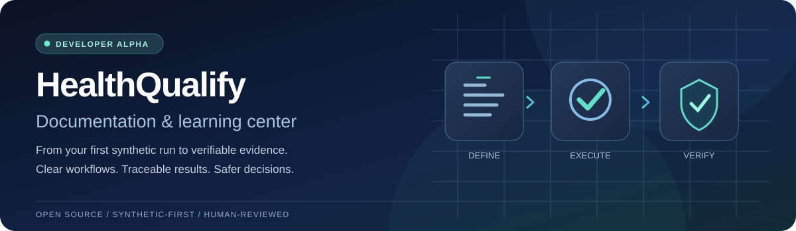
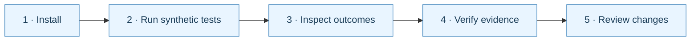

<div align="center">



# Build confidence into every test.

**The complete guide to installing, extending, and evaluating HealthQualify.**  
Follow a practical path from your first synthetic qualification run to traceable results, technical evidence, and human review.

[**🚀 Start in 5 minutes**](GETTING_STARTED.md) · [**🧪 Try the evaluation**](EVALUATION_GUIDE.md) · [**🧭 Explore all guides**](#browse-the-documentation)

   

</div>

> [!IMPORTANT]
> **Developer alpha — not approved for patient care or regulated production.** Use only synthetic or public non-sensitive data. A passing test or verified manifest is technical evidence, **not** FDA approval, GxP validation, or a legally valid electronic signature. [Read the current limitations](SECURITY_AND_LIMITATIONS.md).

---

## Where would you like to start?

Pick the journey that matches your goal. Each path begins with a practical guide—not a wall of reference links.

| | | |
| :--- | :--- | :--- |
| **🌱 I'm new here** | **🧩 I want to test my project** | **🛠️ I'm a developer** |
| Install HealthQualify, understand its purpose, and execute the first synthetic test. | Adapt a supported protocol, understand acceptance criteria, and verify evidence. | Explore the API, source architecture, custom assertions, and automated tests. |
| **[Start the quickstart →](GETTING_STARTED.md)** | **[Open the user guide →](USER_GUIDE.md)** | **[Explore developer docs →](DEVELOPER_ARCHITECTURE.md)** |
| **🧪 I'm evaluating the tool** | **🏥 I work in healthcare QA** | **🔐 I own security or operations** |
| Follow a reproducible 30–60-minute evaluation and understand what is ready today. | Explore healthcare use cases, qualification methodology, templates, and review boundaries. | Understand trust boundaries, supported deployment modes, and production-readiness gaps. |
| **[Run the evaluation →](EVALUATION_GUIDE.md)** | **[Explore healthcare workflows →](HEALTHCARE_USE_CASES.md)** | **[Review the security model →](SECURITY_MODEL.md)** |

## Your first successful experience

A simple route from a new checkout to evidence you can inspect and verify.



**Run the built-in example** from the repository root:

```bash
git clone https://github.com/Tec-Wel/HealthQualify.git
cd HealthQualify
python -m unittest discover -s tests -v
python -m healthqualify.v05cli run examples/synthetic_lis_v3/protocol.json --out .healthqualify/first-run
```

> [!NOTE]
> The demonstration intentionally returns **2 PASS and 5 FAIL**, with an exit code of **1**. Detecting those seeded defects is the expected result, not a broken installation. Save the printed `manifest_sha256` independently, then follow the [verification walkthrough](VERIFICATION_GUIDE.md).

[**Installation by operating system →**](INSTALLATION.md) · [**Complete hands-on workflow →**](END_TO_END_WORKFLOW.md)

---

## Browse the documentation

### 📖 Learn & use

*Everything needed to go from zero setup to a reproducible technical evidence package.*

| Guide | What you'll get |
| :--- | :--- |
| **[🚀 Getting Started](GETTING_STARTED.md)** | Your first run, expected results, and evidence verification |
| **[💻 Installation](INSTALLATION.md)** | Windows, macOS, Linux, Python environments, and local Docker |
| **[🧭 User Guide](USER_GUIDE.md)** | Build a project-specific synthetic protocol and interpret outcomes |
| **[🔄 End-to-End Workflow](END_TO_END_WORKFLOW.md)** | Requirements → protocol → execution → deviations → requalification |
| **[🧪 Worked Examples](EXAMPLES.md)** | LIS, REST, FHIR, impact assessment, and local workspace examples |
| **[✅ Verification & Evidence](VERIFICATION_GUIDE.md)** | SHA-256 manifests, independent trust anchors, and negative checks |

### 🏥 Healthcare quality & qualification

*Understand the domain context and the boundary between engineering evidence and formal QA decisions.*

| Guide | What you'll get |
| :--- | :--- |
| **[🏥 Healthcare Use Cases](HEALTHCARE_USE_CASES.md)** | LIS/EHR, FHIR, access control, DICOM, equipment snapshots |
| **[📋 Qualification Methodology](QUALIFICATION_METHODOLOGY.md)** | URS/FRS, risk, IQ/OQ/PQ, CSA, findings, retests |
| **[🧾 Ready-to-Edit Templates](VALIDATION_TEMPLATES.md)** | Synthetic requirements, risk, traceability, deviations, review forms |
| **[⚖️ Regulatory Mapping](REGULATORY_MAPPING.md)** | Scope and applicability guidance—not a conformity claim |

### </> Build & integrate

*Reference material for people extending and maintaining the software.*

| Guide | What you'll get |
| :--- | :--- |
| **[🔌 API Reference](API_REFERENCE.md)** | Local secure API endpoints, roles, requests, responses |
| **[⌨️ CLI Reference](CLI_REFERENCE.md)** | Commands, arguments, expected exit statuses |
| **[🧱 Developer Architecture](DEVELOPER_ARCHITECTURE.md)** | Module boundaries, data and evidence flows |
| **[🧩 Custom Adapter Guide](CUSTOM_ADAPTER_GUIDE.md)** | Reviewed allowlisted checks and restricted test interfaces |
| **[⚙️ Configuration](CONFIGURATION.md)** | JSON protocol schemas, safety policies, environment variables |
| **[🔗 Integration Guide](INTEGRATION_GUIDE.md)** | Local REST, approved staging FHIR, HL7/DICOM prototypes, CI |
| **[🧪 Testing & CI](TESTING_AND_CI.md)** | Automated suites, negative cases, GitHub Actions workflows |

### 🛡️ Evaluate & operate

*Make informed adoption decisions with explicit capabilities and limitations.*

| Guide | What you'll get |
| :--- | :--- |
| **[🎯 Evaluation Guide](EVALUATION_GUIDE.md)** | A 30–60-minute reproducible technical evaluation |
| **[📊 Feature Matrix](FEATURE_MATRIX.md)** | Implemented vs experimental vs planned vs unsupported |
| **[🚚 Migration Guide](MIGRATION_GUIDE.md)** | Map existing scripts and requirements to supported fixtures |
| **[🔐 Security Model](SECURITY_MODEL.md)** | Assets, threat boundaries, identity roles, trust gaps |
| **[🚦 Production Readiness](PRODUCTION_READINESS_CHECKLIST.md)** | Explicit blockers and review gates before any expansion |
| **[☁️ Deployment Guide](DEPLOYMENT_GUIDE.md)** | Supported local setup vs proposed enterprise architectures |
| **[🧰 Operations Runbook](OPERATIONS_RUNBOOK.md)** | Startup, diagnostics, technical backups, incident handling |
| **[🆘 Troubleshooting](TROUBLESHOOTING.md)** | Error explanations, next steps, useful diagnostics |
| **[❓ Frequently Asked Questions](FAQ.md)** | Straight answers to common adoption questions |

---

## Understand the current product boundaries

HealthQualify currently offers **two separate, complementary paths**. Choose the one that matches your task.

| **Standalone synthetic runner** | **SQLite workspace & local API** |
| :--- | :--- |
| **Strict v0.3 JSON protocol** | **v0.2 workspace protocol** |
| Offline deterministic checks | Local records for systems, drafts, baselines, runs, deviations |
| Exports `protocol.json`, `results.json`, `manifest.json` | Local identity, role checks, technical QA records |
| Manifest verification + deterministic replay | Developer-alpha local API on loopback |
| **[Start the synthetic runner →](GETTING_STARTED.md)** | **[Explore the workspace workflow →](END_TO_END_WORKFLOW.md)** |

**There is no automatic bridge between these protocol versions.** Neither path automatically approves qualification. Review the [feature matrix](FEATURE_MATRIX.md) before planning an integration.

## Resources for maintainers & contributors

| **Contribute** | **Project & trust** |
| :--- | :--- |
| [🤝 Contributing guide](../CONTRIBUTING.md) | [🔒 Security reporting](../SECURITY.md) |
| [💬 Get support](../SUPPORT.md) | [📌 Release status](RELEASE_STATUS.md) |
| [🛠️ Project roadmap](ROADMAP.md) | [📝 Changelog](../CHANGELOG.md) |
| [🐛 Report an issue](https://github.com/Tec-Wel/HealthQualify/issues) | [🏷️ Versioning policy](VERSIONING_POLICY.md) |

<details>
<summary><strong>ℹ️ About this documentation and publishing a website</strong></summary>

This page is designed to render well **inside GitHub Markdown**, using a branded banner, visual pathways, searchable headings, tables, and collapsible details. The repository currently remains **private**. The separate `mkdocs.yml` is a local documentation-site configuration, not a deployed public website. Publishing documentation publicly requires a deliberate repository visibility and disclosure decision.

</details>

---

<div align="center">

**Ready to see HealthQualify in action?**

[**🚀 Follow the Quickstart**](GETTING_STARTED.md) · [**🧪 Run the Evaluation**](EVALUATION_GUIDE.md) · [**📚 Back to Project Overview**](../README.md)

<sub>Open-source engineering tools · Synthetic data only · Human-reviewed qualification decisions</sub>

</div>
