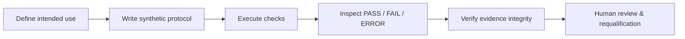

[← **Documentation home**](README.md) &nbsp; / &nbsp; **Find a guide**

# Documentation library

**One place to locate the exact answer—without searching through dozens of filenames.** Select a goal below, then open a focused guide with prerequisites, examples and related reading.

**[🚀 Get started](GETTING_STARTED.md)** · **[🧪 Evaluate in 30–60 minutes](EVALUATION_GUIDE.md)** · **[↖ Folder home](README.md)**

---

## What do you want to do?

| Your goal | Best starting point | Then read |
| :--- | :--- | :--- |
| **Get HealthQualify running** | [Installation by OS](INSTALLATION.md) | [First qualification run](GETTING_STARTED.md) |
| **Test a synthetic project** | [User guide](USER_GUIDE.md) | [Protocol configuration](CONFIGURATION.md) |
| **Verify an evidence bundle** | [Evidence guide](VERIFICATION_GUIDE.md) | [End-to-end workflow](END_TO_END_WORKFLOW.md) |
| **Connect a safe test service** | [Integration guide](INTEGRATION_GUIDE.md) | [REST and FHIR examples](EXAMPLES.md) |
| **Extend Python checks** | [Developer architecture](DEVELOPER_ARCHITECTURE.md) | [Custom adapter guide](CUSTOM_ADAPTER_GUIDE.md) |
| **Explore QA workflows** | [Healthcare use cases](HEALTHCARE_USE_CASES.md) | [Qualification methodology](QUALIFICATION_METHODOLOGY.md) |
| **Investigate with agents** | [Five local agents](AI_AGENTS_GUIDE.md) | [Agent dashboard](AI_AGENT_DASHBOARD.md) |
| **Review risk and maturity** | [Feature matrix](FEATURE_MATRIX.md) | [Production readiness](PRODUCTION_READINESS_CHECKLIST.md) |

## Six documentation collections

| **🚀 Learn & use** | **🧩 Build & extend** | **🏥 Healthcare QA** |
| :--- | :--- | :--- |
| [Getting started](GETTING_STARTED.md) | [API reference](API_REFERENCE.md) | [Healthcare use cases](HEALTHCARE_USE_CASES.md) |
| [Installation](INSTALLATION.md) | [CLI reference](CLI_REFERENCE.md) | [Qualification method](QUALIFICATION_METHODOLOGY.md) |
| [User guide](USER_GUIDE.md) | [Architecture](DEVELOPER_ARCHITECTURE.md) | [Validation templates](VALIDATION_TEMPLATES.md) |
| [Examples](EXAMPLES.md) | [Custom adapters](CUSTOM_ADAPTER_GUIDE.md) | [Regulatory mapping](REGULATORY_MAPPING.md) |
| **🛡️ Security & operations** | **🤖 AI investigators** | **📋 Project & history** |
| [Security model](SECURITY_MODEL.md) | [Agent guide](AI_AGENTS_GUIDE.md) | [Release status](RELEASE_STATUS.md) |
| [Evidence integrity](VERIFICATION_GUIDE.md) | [Dashboard](AI_AGENT_DASHBOARD.md) | [Roadmap](ROADMAP.md) |
| [Operations runbook](OPERATIONS_RUNBOOK.md) | [Feature matrix](FEATURE_MATRIX.md) | [Product specification](PRODUCT.md) |
| [Production readiness](PRODUCTION_READINESS_CHECKLIST.md) | [Testing & CI](TESTING_AND_CI.md) | [Versioning](VERSIONING_POLICY.md) |

## Core qualification workflow

> [!IMPORTANT]
> **Developer alpha only.** Use synthetic or public non-sensitive data, never PHI. Standalone v0.5 uses strict **v0.3 JSON**; the separate SQLite workspace uses **v0.2 JSON**. No automatic import connects these workflows, and no technical result is a regulatory approval. [Review the boundaries](SECURITY_AND_LIMITATIONS.md).

<strong>📂 Expand the complete reference shelf</strong>

### Tutorials and adoption

[End-to-end workflow](END_TO_END_WORKFLOW.md) · [Evaluation](EVALUATION_GUIDE.md) · [Migration](MIGRATION_GUIDE.md) · [FAQ](FAQ.md) · [Troubleshooting](TROUBLESHOOTING.md)

### Developer references

[Configuration](CONFIGURATION.md) · [Testing & CI](TESTING_AND_CI.md) · [Architecture and trust](ARCHITECTURE.md) · [Integration](INTEGRATION_GUIDE.md)

### Healthcare and security

[Earlier v0.2 qualification](HEALTHCARE_V02.md) · [Security and limitations](SECURITY_AND_LIMITATIONS.md) · [Deployment](DEPLOYMENT_GUIDE.md) · [Evidence/technical retention](REST_TRACE_RECOVERY.md)

### Platform evolution

[Local platform v0.3](PLATFORM_V03.md) · [Security/interoperability v0.4](SECURITY_INTEROP_V04.md) · [v0.5 backlog](V05_BACKLOG_CONVERGENCE.md) · [v0.6 quality & benchmark](QUALITY_RELEASE_BENCHMARK_V06.md) · [Issue hardening](ISSUE_HARDENING.md)

### Project and contributor guides

[Contributing](../CONTRIBUTING.md) · [Support](../SUPPORT.md) · [Security reporting](../SECURITY.md) · [Changelog](../CHANGELOG.md) · [Documentation design guidelines](DESIGN_GUIDELINES.md)

---

**Need a starting point?** [Open the documentation homepage](README.md) or [run the first example](GETTING_STARTED.md).

Synthetic only · Local first · Traceable evidence · Human review

