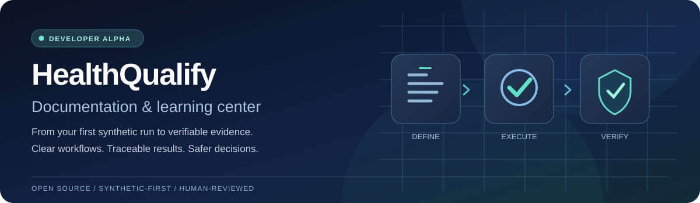
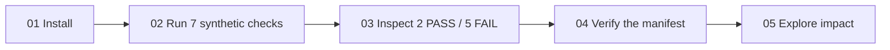

<div align="center">



# Everything you need to build with HealthQualify

**Start in minutes. Go deeper when you're ready.**  
Guided tutorials, practical healthcare workflows, API references, and honest security boundaries—all in one place.

**[🚀 Get started](GETTING_STARTED.md)** · **[🧪 Try the evaluation](EVALUATION_GUIDE.md)** · **[🛠️ Build and extend](DEVELOPER_ARCHITECTURE.md)**

  

</div>

> [!IMPORTANT]
> **Developer-alpha engineering tools, not clinical or regulated-production software.** Use only synthetic or public non-sensitive fixtures. Technical PASS, manifest verification, or an AI suggestion does not qualify a system or replace human QA approval. [Understand the security boundaries](SECURITY_AND_LIMITATIONS.md).

---

## Choose your path

| | | |
| :--- | :--- | :--- |
| **🌱 New to HealthQualify** | **🧪 Validating a project** | **🧑‍💻 Extending the code** |
| Understand the tools, set up Python, and complete your first synthetic run. | Define requirements, inspect traceability and validate evidence hashes. | Learn internals, CLI/API interfaces, and how to build safe checks. |
| **[Follow the quickstart →](GETTING_STARTED.md)** | **[Open the end-to-end guide →](END_TO_END_WORKFLOW.md)** | **[Explore architecture →](DEVELOPER_ARCHITECTURE.md)** |
| **🏥 Healthcare QA team** | **🔐 Security / operations** | **🤖 Exploring AI agents** |
| LIS, FHIR, IQ/OQ/PQ, quality records and synthetic example templates. | Understand limitations, access control, deployment and recovery workflows. | Explore five local advisory agents and the experimental local dashboard. |
| **[Healthcare use cases →](HEALTHCARE_USE_CASES.md)** | **[Security & trust model →](SECURITY_MODEL.md)** | **[Agent guide →](AI_AGENTS_GUIDE.md)** |

## Your first 10 minutes



```bash
git clone https://github.com/Tec-Wel/HealthQualify.git
cd HealthQualify
python -m unittest discover -s tests -v
python -m healthqualify.v05cli run examples/synthetic_lis_v3/protocol.json --out .healthqualify/first-run
```

> [!NOTE]
> The bundled LIS scenario **intentionally fails five checks**. Exit code 1 is expected for that last command; the example is demonstrating fault detection. Record the printed `manifest_sha256` outside the bundle and follow the [verification guide](VERIFICATION_GUIDE.md).

---

## Explore the learning library

### 🚀 Start here — get productive

| Guide | What you'll accomplish |
| :--- | :--- |
| [**Getting started**](GETTING_STARTED.md) | Execute your first run and inspect verifiable evidence |
| [**Install by OS**](INSTALLATION.md) | Windows, macOS, Linux and optional local Docker |
| [**User guide**](USER_GUIDE.md) | Apply synthetic qualification concepts to your own project |
| [**End-to-end workflow**](END_TO_END_WORKFLOW.md) | Follow a realistic requirement-to-review journey |
| [**Evaluation walkthrough**](EVALUATION_GUIDE.md) | Assess capabilities in 30–60 minutes |
| [**Worked examples**](EXAMPLES.md) | Learn through LIS, FHIR, REST and change impact |

### 🧩 Build and extend — developer handbook

| Guide | What you'll accomplish |
| :--- | :--- |
| [**Developer architecture**](DEVELOPER_ARCHITECTURE.md) | Understand modules, data flows and design boundaries |
| [**API reference**](API_REFERENCE.md) | Local authenticated endpoints, payloads and permissions |
| [**CLI reference**](CLI_REFERENCE.md) | Command catalog and exit codes |
| [**Configuration**](CONFIGURATION.md) | Author strict protocol JSON and configure supported options |
| [**Custom adapter guide**](CUSTOM_ADAPTER_GUIDE.md) | Extend deterministic checks through reviewed source code |
| [**Integration guide**](INTEGRATION_GUIDE.md) | Bounded REST/FHIR and offline healthcare adapters |
| [**Testing and CI**](TESTING_AND_CI.md) | Unit tests, GitHub Actions, quality checks |

### 🏥 Healthcare qualification — evidence with context

| Guide | What you'll accomplish |
| :--- | :--- |
| [**Healthcare use cases**](HEALTHCARE_USE_CASES.md) | Explore seven representative synthetic scenarios |
| [**Qualification methodology**](QUALIFICATION_METHODOLOGY.md) | Requirements, risk, test phases and human review |
| [**Validation templates**](VALIDATION_TEMPLATES.md) | Copy synthetic traceability, deviation and review worksheets |
| [**Regulatory mapping**](REGULATORY_MAPPING.md) | Understand standards applicability, not certification |
| [**Healthcare v0.2 guide**](HEALTHCARE_V02.md) | Explore earlier synthetic LIS qualification checks |

### 🛡️ Trust and operations — know the boundaries

| Guide | What you'll accomplish |
| :--- | :--- |
| [**Security model**](SECURITY_MODEL.md) | Identify trust boundaries, roles and known gaps |
| [**Security & limitations**](SECURITY_AND_LIMITATIONS.md) | Evaluate privacy and regulated-use exclusions |
| [**Feature matrix**](FEATURE_MATRIX.md) | Compare implemented, experimental and unsupported capabilities |
| [**Production readiness checklist**](PRODUCTION_READINESS_CHECKLIST.md) | Understand what would be required before production |
| [**Deployment guide**](DEPLOYMENT_GUIDE.md) | Local setup versus future reference designs |
| [**Operations runbook**](OPERATIONS_RUNBOOK.md) | Backup, restore, diagnostics and incident handling |
| [**Verification guide**](VERIFICATION_GUIDE.md) | Validate technical evidence using a trusted digest |
| [**Troubleshooting**](TROUBLESHOOTING.md) | Solve common setup and execution issues |

### 🤖 AI and agent tools — advisory, not authoritative

| Guide | What you'll accomplish |
| :--- | :--- |
| [**Five local AI agents**](AI_AGENTS_GUIDE.md) | Investigate release, qualification and evidence questions |
| [**Agent dashboard & orchestration**](AI_AGENT_DASHBOARD.md) | Explore loopback-only local agent UI and CLI |

### 📋 Product, releases and community

| Guide | What you'll accomplish |
| :--- | :--- |
| [**Product specification**](PRODUCT.md) | Understand the long-term product goals |
| [**Architecture and trust boundaries**](ARCHITECTURE.md) | Study the earlier architecture model |
| [**Implementation and release status**](RELEASE_STATUS.md) | Know what's implemented and what's not |
| [**Roadmap**](ROADMAP.md) | See proposed directions, without assuming delivery |
| [**v0.3 local platform**](PLATFORM_V03.md) | Explore the SQLite workspace evolution |
| [**v0.4 security & interoperability**](SECURITY_INTEROP_V04.md) | Inspect technical security prototypes |
| [**v0.5 backlog convergence**](V05_BACKLOG_CONVERGENCE.md) | Review runner and assurance hardening |
| [**v0.6 QA & benchmark workflows**](QUALITY_RELEASE_BENCHMARK_V06.md) | Study release plans, review, retention and benchmarks |
| [**Evidence trace and recovery**](REST_TRACE_RECOVERY.md) | Examine evidence linkage and restored-state boundaries |
| [**Issue hardening**](ISSUE_HARDENING.md) | Read integrity and impact constraints |
| [**Versioning policy**](VERSIONING_POLICY.md) | Understand release provenance expectations |
| [**Migration guide**](MIGRATION_GUIDE.md) | Plan safe manual conversion of existing tests |
| [**FAQ**](FAQ.md) | Fast answers to common questions |

---

## Understand the two qualification tracks

| **Strict synthetic runner** | **Local SQLite workflow** |
| :--- | :--- |
| Uses **v0.3 JSON protocols** through `healthqualify.v05cli` | Uses **v0.2 protocols** through `healthqualify.appcli` |
| Produces technical `protocol.json`, `results.json`, `manifest.json` | Stores systems, drafts, baselines, runs, deviations and audit records |
| Validates artifact hashes and deterministic replay | Supports local QA workflow records and a separate secure loopback API |
| [**Start with the runner →**](GETTING_STARTED.md) | [**Follow the workspace steps →**](END_TO_END_WORKFLOW.md) |

**No automatic v0.3 → SQLite import exists.** Both tracks are developer-alpha tools; neither issues regulated approval.

---

<div align="center">

### Ready to make your first run?

**[🚀 Start here](GETTING_STARTED.md)** · **[📚 Detailed index](DOCUMENTATION_INDEX.md)** · **[↗ Repository home](../README.md)**

<sub>Open source · Synthetic-first · Inspectable evidence · Human quality decisions</sub>

</div>
