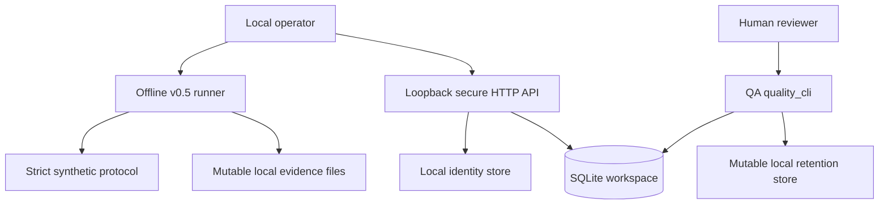

[← **Documentation home**](README.md) &nbsp; / &nbsp; **Trust & operations**

# Security model and threat boundaries

> **What you'll learn:** Review explicit threats, assets, identity permissions and necessary security hardening.

**On this page:** [Assumptions and supported use](#assumptions-and-supported-use) · [Assets, threats and mitigations](#assets-threats-and-mitigations) · [Authorization matrix (secure API)](#authorization-matrix-secure-api) · [Abuse cases to test before extending](#abuse-cases-to-test-before-extending)

---

## Assumptions and supported use

HealthQualify is a **non-production developer alpha** intended for synthetic/public non-sensitive information. It is not safe or validated for PHI, multi-tenant hospital records, direct device control or regulated electronic approval.

### Trust boundary diagram

No external authorization, trusted timestamps, public-service protection or immutability is established. Standalone evidence hashes become meaningful against a **separately held, trusted reference digest**, not a digest kept with the data it purports to protect.

## Assets, threats and mitigations

| Asset | Threat | Existing engineering control | Gap / owner action |
| --- | --- | --- | --- |
| Synthetic protocol | Arbitrary code execution via JSON | Strict fields, allowlisted checks, network/AI/destructive disabled | Review extension code, no general sandbox claim |
| Local REST result | SSRF/redirect or raw response leakage | Explicit `127.0.0.1` or `::1`, `/test/` path, GET, bounded response, redacted output | Additional OS network isolation |
| FHIR staging request | Unauthorized external read | Explicit approved HTTPS origin, read-only flag, no redirects | Strong egress/DNS policy, formal authorization |
| SQLite workspace | Unauthorized local file edits | API roles and authentication at service layer | OS file ACLs, encryption, independent audit integrity |
| API session | Token theft, brute-force | Random opaque hashed tokens, short duration, role checks | MFA, lockout/rate limiting, HTTPS public infrastructure |
| Evidence bundle | Tampering or forged PASS | SHA-256 digests, deterministic replay and separately trusted anchor | Immutable storage, trusted time, trusted verifier deployment |
| Protected export key | Secret exposure / misuse | Runtime env keys, AES-GCM and Ed25519 technical receipts | KMS/HSM, rotation/revocation, secrets policy |
| CI release plan | Unmapped dependency or false green | `UNKNOWN_IMPACT` escalates all cases, human review required | Dependency analysis and protected release governance |
| Local retention | Artifact modification or deletion | Exclusive-write copy, checksum, hold metadata | True WORM, retention enforcement, independent backups |
| Optional LLM draft | Hallucinated test verdict or unsafe approval | Draft-only interface, no authoritative decision | Model security evaluation and governance |

## Authorization matrix (secure API)

| Role | Read | Write draft/system | Execute | Baseline | Audit | Manage users |
| --- | --- | --- | --- | --- | --- | --- |
| admin | ✓ | ✓ | ✓ | ✓ | ✓ | ✓ |
| qa | ✓ | — | — | ✓ | ✓ | — |
| validator | ✓ | ✓ | ✓ | — | — | — |
| viewer | ✓ | — | — | — | — | — |

Identity is local PBKDF2-HMAC-SHA256 password-based with randomized salts and local session tokens. This **does not** substitute for enterprise identity federation, phishing-resistant MFA or institution-managed user lifecycle.

## Abuse cases to test before extending

1. Protocol adds an unknown executable command → reject, not execute.
2. Unsupported external URL or local non-`/test/` path → reject.
3. Redirect to another host → reject, including redirect chains.
4. Tampered `results.json` with original digest → verify false.
5. Forged PASS with rehashed manifest → deterministic replay rejects where supported, assuming trusted verifier.
6. Unauthorized QA/validator operation → deny; do not trust body-specified username.
7. Unmapped source file → all tests recommended and human review required.
8. Missing / changed source artifact → never auto-approve a release.

## Hardening backlog before production

Conduct formal threat modeling, independent penetration testing, dependency/SAST/DAST checks, data privacy assessments, KMS/HSM integration, network isolation, centralized audit with independent retention, SSO/MFA, TLS, tenant authorization, protected QMS review, time synchronization, disaster recovery and documented tool validation for intended use.

Security reports: [SECURITY.md](../SECURITY.md). Operations: [Runbook](OPERATIONS_RUNBOOK.md). The above is a model of **current controls and known gaps**, not a third-party audit.

---

### Continue exploring

[verification guide](VERIFICATION_GUIDE.md) · [production readiness checklist](PRODUCTION_READINESS_CHECKLIST.md) · [All guides](README.md) · [Project homepage](../README.md)
