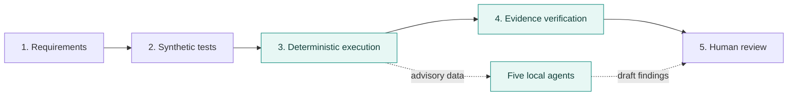

# Qualify with evidence. Not assumptions.

**A clear, local-first workspace for healthcare software qualification.** Connect requirements to synthetic test results, inspect source-linked findings, and see what needs review before the next software change.

**[🚀 Start with a five-minute demo](GETTING_STARTED.md)** · **[🤖 Explore the five AI agents](AI_AGENTS_GUIDE.md)** · **[🖥️ Open the local dashboard guide](AI_AGENT_DASHBOARD.md)**

!!! warning "Developer alpha · Synthetic inputs only"
    HealthQualify is an engineering toolkit—not FDA certification, a validated GxP system, or a clinical tool. Never use PHI or live healthcare production systems in this alpha. Agent recommendations cannot approve qualification or override test evidence.

---

## Choose your starting point

| **01 · Get started** | **02 · Explore AI intelligence** | **03 · Evaluate qualification** |
| :--- | :--- | :--- |
| **Your first successful technical test** | **Five source-linked local investigators** | **Understand the evidence trail** |
| Install the project, run the synthetic laboratory example, and understand the deliberately failing checks. | Investigate release impact, gaps, test failures, review readiness, and dependencies—with optional local Qwen. | Review deterministic outcomes, verified evidence, change impact, and current regulatory limitations. |
| **[Start the quickstart →](GETTING_STARTED.md)** | **[Meet the five agents →](AI_AGENTS_GUIDE.md)** | **[Explore the evaluation →](EVALUATION_GUIDE.md)** |

## What HealthQualify helps you do

| **Define & connect** | **Execute & verify** | **Investigate & review** |
| :--- | :--- | :--- |
| Intended use, source-backed requirements, acceptance criteria, risk tags, and mapped tests. | Deterministic synthetic checks, traceable results, reproducible evidence verification. | Change impact, qualification gaps, nonpassing tests, cross-system dependencies, and human quality review. |
| [Requirements and protocols →](CONFIGURATION.md) | [Evidence verification →](VERIFICATION_GUIDE.md) | [Five AI agents →](AI_AGENTS_GUIDE.md) |

## From a requirement to a reviewable result



The agents investigate. The deterministic engine records test outcomes. Authorized people make final qualification decisions.

## Try it locally

Run from the HealthQualify repository root. Python 3.10+ is required.

```bash
git clone https://github.com/Tec-Wel/HealthQualify.git
cd HealthQualify
python -m unittest tests.test_agents tests.test_agent_orchestrator -v

# Run a local, no-LLM qualification-gap investigation
python -m healthqualify.agentcli gap-hunter examples/synthetic_lis_v3/protocol.json
```

**Want the browser experience?** [Set up the local dashboard →](AI_AGENT_DASHBOARD.md). Prefer the full documentation library? [Browse every guide →](DOCUMENTATION_INDEX.md).

---

**Local first · AI optional · Synthetic only · Human-reviewed decisions**

[GitHub repository](https://github.com/Tec-Wel/HealthQualify) · [Installation](INSTALLATION.md) · [Security model](SECURITY_MODEL.md) · [Contributing](https://github.com/Tec-Wel/HealthQualify/blob/main/CONTRIBUTING.md)
