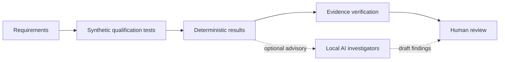

# Qualify with evidence, not assumptions.

**Local-first engineering tools for software qualification, traceable synthetic tests, and review-ready findings.**

[**🚀 First run**](GETTING_STARTED.md) · [**🤖 Explore AI agents**](AI_AGENTS_GUIDE.md) · [**🖥️ Local dashboard**](AI_AGENT_DASHBOARD.md) · [**📚 All documentation**](DOCUMENTATION_INDEX.md)

> [!IMPORTANT]
> **Developer alpha:** This software is not a validated GxP system or FDA-approved qualification authority. Use only synthetic or public non-sensitive data. AI suggestions do not change authoritative test outcomes or issue regulatory approvals.

## Choose a starting point

| **🌱 New to HealthQualify** | **🤖 Exploring AI agents** | **🔐 Evaluating for healthcare QA** |
| :--- | :--- | :--- |
| Install the toolkit, run a synthetic protocol, and understand why some tests intentionally fail. | Meet the five local investigators, compare their responsibilities, and optionally enable Qwen. | Understand intended use, evidence verification, safety boundaries, and production-readiness gaps. |
| **[Start the 5-minute walkthrough →](GETTING_STARTED.md)** | **[Explore the five-agent guide →](AI_AGENTS_GUIDE.md)** | **[Review the product limits →](PRODUCTION_READINESS_CHECKLIST.md)** |

## How HealthQualify works

| **Documentation path** | **What you'll learn** |
| :--- | :--- |
| [Getting started](GETTING_STARTED.md) | First successful synthetic qualification run |
| [User guide](USER_GUIDE.md) | Review test outcomes and source records |
| [AI agents](AI_AGENTS_GUIDE.md) | Investigate change impact, qualification gaps, failures, readiness, and dependencies |
| [AI dashboard](AI_AGENT_DASHBOARD.md) | Run five agents and inspect local history |
| [Evidence verification](VERIFICATION_GUIDE.md) | Understand hashes and independent trust anchors |
| [Security model](SECURITY_MODEL.md) | Local access, data boundaries, and current limitations |
| [Complete documentation index](DOCUMENTATION_INDEX.md) | Browse every guide |

---

**Open source · Local first · AI optional · Synthetic-only developer alpha**

[Repository](https://github.com/Tec-Wel/HealthQualify) · [Installation](INSTALLATION.md) · [Contributing](https://github.com/Tec-Wel/HealthQualify/blob/main/CONTRIBUTING.md)

