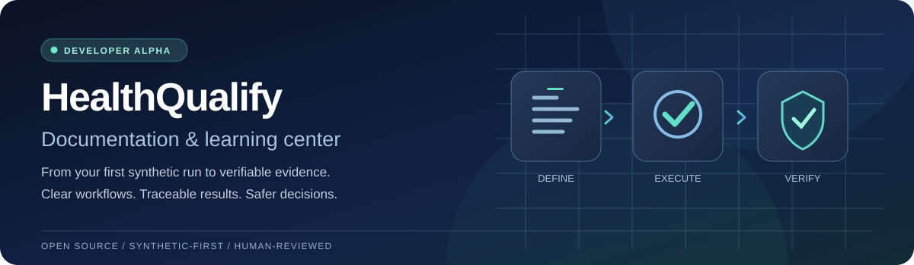
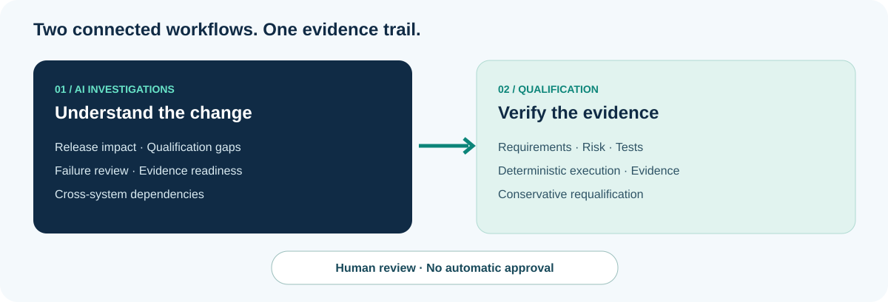
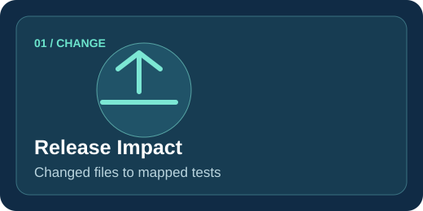
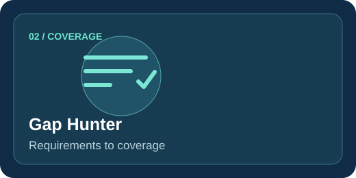
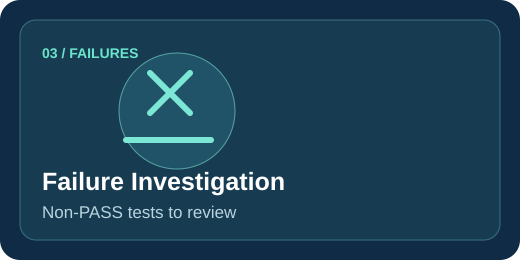
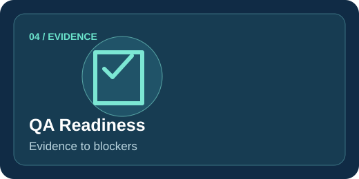
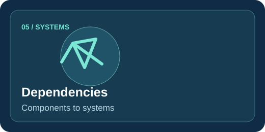

---
hide:
  - navigation
  - toc
---



# Qualify with evidence. Not assumptions.

**A local-first software qualification toolkit with five advisory investigators.** Start with a synthetic test, trace its evidence, and understand the effect of software changes.

**[🚀 Start the quickstart](GETTING_STARTED.md)** · **[🤖 Meet the five agents](AI_AGENTS_GUIDE.md)** · **[🖥️ Launch the dashboard](AI_AGENT_DASHBOARD.md)**

!!! warning "Developer alpha · Synthetic data only"
    Not an FDA-certified or GxP-validated application. No PHI, production clinical systems, or AI-driven approvals. See the [current limitations](SECURITY_AND_LIMITATIONS.md).

## Choose a journey

| **01 · First-run experience** | **02 · Five local investigators** | **03 · Qualification workflows** |
| :--- | :--- | :--- |
| Run the built-in synthetic protocol and understand intentionally seeded failing checks. | Map changes, identify qualification gaps, investigate failures, review evidence and dependencies. | Understand requirements, deterministic checks, evidence verification and review readiness. |
| [**Start in five minutes →**](GETTING_STARTED.md) | [**Explore the agents →**](AI_AGENTS_GUIDE.md) | [**Understand qualification →**](USER_GUIDE.md) |

## Two workflows, one evidence trail



The agents explain and investigate; deterministic checks establish technical outcomes. Final qualification decisions remain with authorized human reviewers.

## Meet the investigators

| | | |
| :--- | :--- | :--- |
| [](AI_AGENTS_GUIDE.md) | [](AI_AGENTS_GUIDE.md) | [](AI_AGENTS_GUIDE.md) |
| [](AI_AGENTS_GUIDE.md) | [](AI_AGENTS_GUIDE.md) | **Run locally**<br>Default: deterministic, no model required.<br>[**Agent command guide →**](AI_AGENTS_GUIDE.md) |

## Try it now

```bash
git clone https://github.com/Tec-Wel/HealthQualify.git
cd HealthQualify
python -m unittest tests.test_agents tests.test_agent_orchestrator -v
python -m healthqualify.agentcli gap-hunter examples/synthetic_lis_v3/protocol.json
```

For the UI, follow the [local dashboard setup](AI_AGENT_DASHBOARD.md). For a full synthetic qualification run, follow the [end-to-end workflow](END_TO_END_WORKFLOW.md).

## Documentation paths

| **Use** | **Extend** | **Trust & review** |
| :--- | :--- | :--- |
| [Installation](INSTALLATION.md) | [Developer architecture](DEVELOPER_ARCHITECTURE.md) | [Security model](SECURITY_MODEL.md) |
| [End-to-end workflow](END_TO_END_WORKFLOW.md) | [Testing & CI](TESTING_AND_CI.md) | [Production limitations](PRODUCTION_READINESS_CHECKLIST.md) |
| [Documentation library](DOCUMENTATION_INDEX.md) | [Contributor visual guide](CONTRIBUTOR_VISUAL_GUIDE.md) | [Evidence verification](VERIFICATION_GUIDE.md) |

---

**Evidence first · AI optional · Local default · Human accountable**

[Repository](https://github.com/Tec-Wel/HealthQualify) · [Visual design system](DESIGN_GUIDELINES.md) · [Screenshot guide](VISUAL_ASSETS_GUIDE.md)
